# MCP Explorer

A hands-on project for learning **MCP (Model Context Protocol)** by building both halves of the protocol ourselves — a server, then a client — one small, understandable step at a time.

> This README is also published as a browsable page: **[MCP Explorer](https://claude.ai/code/artifact/2ac1d88f-d347-40a2-ac23-1febc68554d0)**. It mirrors everything here — keep both in sync as the plan changes.

## What is MCP?

MCP (Model Context Protocol) is a standard way for an AI assistant to call out to external tools and data, instead of every app inventing its own custom integration. You write an **MCP server** that exposes a small set of capabilities — **tools** (functions the assistant can call), **resources** (read-only data) and **prompts** (reusable request templates) — and any MCP-compatible client (Cursor, Claude Desktop, Claude Code, etc.) can discover and use them the same way. Think of it like a USB port for AI assistants: one common plug, many different devices behind it.

The point of this repo isn't to rush to a "real" server. It's to build enough small, working versions that each new MCP concept has somewhere to attach itself in your head.

## Quick start

```bash
pnpm install
pnpm build
pnpm start:http     # the server, on http://localhost:4768/mcp
```

Then, in another terminal, try a client:

```bash
pnpm client         # scripted CLI client
pnpm web            # web dashboard on http://localhost:4767
```

The server can also run over stdio (`pnpm start`), which is how the Inspector and Cursor can launch it themselves. **Every client and both transports, step by step: [docs/connecting-clients.md](docs/connecting-clients.md).**

## What's in the repo

```
MCP-Explorer/
├── package.json, pnpm-workspace.yaml, tsconfig.base.json
├── docs/
│   ├── connecting-clients.md      # how to connect Cursor, the Inspector, the CLI, the dashboard
│   └── branches/                  # one file per numbered branch: what changed and how to try it
├── constitution/                  # longer project guidance, read on demand
└── packages/
    ├── server/    # @mcp-explorer/server — tools, resources, prompts; stdio and HTTP entry points
    ├── client/    # @mcp-explorer/client — a minimal client built from scratch
    └── web/       # @mcp-explorer/web    — Next.js dashboard that runs the server's tools
```

## Branch history

Every branch gets a global sequence number, and every numbered branch has its own file in [`docs/branches/`](docs/branches/) explaining what happened, the details worth knowing, and how to connect and try it. Read them in order to follow how the project grew.

| # | Branch | What it did |
|---|---|---|
| 1 | [`stage-1-basic-server`](docs/branches/01-stage-1-basic-server.md) | Stage 1: the smallest MCP server, with one tool, `add`. |
| 2 | [`explore-mcp-client`](docs/branches/02-explore-mcp-client.md) | Side exploration: a minimal client written from scratch. |
| 3 | [`03-claude-md-constitution`](docs/branches/03-claude-md-constitution.md) | Side exploration: `CLAUDE.md` and the `constitution/` guidance files. |
| 4 | [`04-stage-2-second-tool-validation`](docs/branches/04-stage-2-second-tool-validation.md) | Stage 2: a second tool, `divide`, and validation with a custom rule. |
| 5 | [`05-stage-3-real-data-source`](docs/branches/05-stage-3-real-data-source.md) | Stage 3: `get_weather`, the first tool that calls a real API. |
| 6 | [`06-monorepo-server-client-split`](docs/branches/06-monorepo-server-client-split.md) | Side exploration: server and client become separate packages. |
| 7 | [`07-web-nextjs-react`](docs/branches/07-web-nextjs-react.md) | Side exploration: the web dashboard rebuilt in Next.js and React. |
| 8 | [`08-server-http-transport`](docs/branches/08-server-http-transport.md) | Side exploration: a standalone Streamable HTTP entry point. |
| 9 | [`09-switch-to-pnpm`](docs/branches/09-switch-to-pnpm.md) | Side exploration: the repo moves from npm to pnpm. |
| 10 | [`10-stage-4-error-handling-realtime`](docs/branches/10-stage-4-error-handling-realtime.md) | Stage 4: timeouts and retries, progress updates, and stateful HTTP sessions. |
| 11 | [`11-stage-4-wrapup`](docs/branches/11-stage-4-wrapup.md) | Stage 4: the dashboard reconnects after a server restart. |
| 12 | [`12-stage-4-verify-docs`](docs/branches/12-stage-4-verify-docs.md) | Stage 4: verified cancel and idle sweep, added the dashboard Cancel button. |
| 13 | [`13-stage-5-resources-prompts`](docs/branches/13-stage-5-resources-prompts.md) | Stage 5: resources, prompts and argument completion, a CLI demo, and a [tool vs resource vs prompt guide](docs/tool-resource-or-prompt.md). |
| 14 | [`14-stage-6-testing-ci`](docs/branches/14-stage-6-testing-ci.md) | Stage 6: Vitest unit, in-memory and HTTP integration tests, a schema snapshot, and a GitHub Actions workflow. |
| 15 | [`15-stage-7-http-framework`](docs/branches/15-stage-7-http-framework.md) | Stage 7: the HTTP entry point moves from hand-written `node:http` to Hono, with the same behaviour. |

> **Branch numbering:** every new branch — a numbered stage or a side exploration — gets the next global sequence number (`NN-description`), so the branch list alone shows true creation order, not just which stages happen to be numbered. `stage-1-basic-server` and `explore-mcp-client` predate the convention (they are #1 and #2) and keep their original names. #3 turned out to be a side exploration rather than Stage 2, which is why the counter is global and does not reserve numbers for stages in advance. Adding a branch means adding its file in `docs/branches/` and a row to the table above.

## Roadmap

Every stage (and every side exploration) gets its own git branch. The habit is: **branch → build → understand it → merge into `main` → branch again for the next thing.** Nothing moves to `main` until it's understood, not just working.

```mermaid
flowchart LR
    S1["Stage 1<br/>Basic server<br/>+ one tool"] --> S2["Stage 2<br/>Second tool<br/>+ input validation"]
    S2 --> S3["Stage 3<br/>Real data source<br/>/ API"]
    S3 --> S4["Stage 4<br/>Error handling, real-time<br/>+ stateful HTTP"]
    S4 --> S5["Stage 5<br/>Resources, prompts<br/>+ completions"]
    S5 --> S6["Stage 6<br/>Testing + CI"]
    S6 --> S7["Stage 7<br/>HTTP framework<br/>(Hono)"]
    S7 --> S8["Stage 8<br/>Code review<br/>server"]
    S8 --> S9["Stage 9<br/>Authentication"]
    S9 --> S10["Stage 10<br/>Authorization<br/>+ hardening"]
    S10 --> S11["Stage 11<br/>Persistence<br/>+ scaling"]
    S11 --> S12["Stage 12<br/>Observability"]
    S12 --> S13["Stage 13<br/>Containerize<br/>+ deploy"]

    classDef built fill:#d1fae5,stroke:#059669,color:#064e3b
    classDef current fill:#fef3c7,stroke:#d97706,color:#78350f
    class S1,S2,S3,S4,S5,S6 built
    class S7 current
```



Green = built and merged, amber = built on a branch, waiting for its PR. Unfilled stages are still planned.

Stages 1–6 build and test the server; Stages 7–8 give it a proper HTTP layer and a real use case; **Stages 9–13 are the enterprise track** — what separates a demo server from one a team can run in production.

1. **Stage 1 — Basic server + one trivial tool** *(on `main`)*
   A server exists, and it can do exactly one thing (`add`). Goal: understand server / tool / transport as separate concepts.
   Details: [#1](docs/branches/01-stage-1-basic-server.md)

2. **Stage 2 — Second tool + input validation** *(on `main`)*
   Add a second, slightly less trivial tool, and lean harder on `zod` — rejecting bad input with clear errors rather than trusting the caller. Goal: see how multiple tools coexist, and what "validation" means beyond just typing.
   Details: [#4](docs/branches/04-stage-2-second-tool-validation.md)

3. **Stage 3 — Connect to a real data source / API** *(on `main`)*
   Swap a toy tool for one that does real (async) work — calling a public API or reading real data. Goal: handle async operations and things that can be slow or unavailable.
   Details: [#5](docs/branches/05-stage-3-real-data-source.md)

4. **Stage 4 — Error handling, a real-time use case & stateful HTTP** *(on `main`)*
   Harden the server against failures (bad responses, timeouts, partial data), add a tool that reports progress while it runs, and add **stateful Streamable HTTP** — an `Mcp-Session-Id` issued on `initialize`, a map of live sessions, one `McpServer` per session. Goal: go from "it works when everything goes right" to "it behaves sensibly when it doesn't," and see why sessions exist at all.
   Details: [#10](docs/branches/10-stage-4-error-handling-realtime.md), [#11](docs/branches/11-stage-4-wrapup.md), [#12](docs/branches/12-stage-4-verify-docs.md)

5. **Stage 5 — Resources, prompts & completions** *(built and merged)*
   Tools are one of three server primitives. Add **resources** (read-only data a client can attach, addressed by URI) and **prompts** (reusable templates the user picks), plus argument completion. Goal: know which primitive fits which job instead of making everything a tool.
   Details: [#13](docs/branches/13-stage-5-resources-prompts.md)

6. **Stage 6 — Testing & CI** *(built and merged)*
   Unit-test tools, integration-test the server through an in-memory transport and through real HTTP, add contract checks on tool schemas, and run it all in GitHub Actions on every PR. Goal: change a server safely before it has real users.
   Details: [#14](docs/branches/14-stage-6-testing-ci.md)

7. **Stage 7 — HTTP framework (Hono)** *(built, not yet merged)*
   Replace the hand-rolled `node:http` entry in `http.ts` (manual body parsing, routing, error handling) with **Hono** (via `@hono/node-server`, bridging to the SDK transport). The session map, idle sweep and transports stay as they are; only the HTTP layer changes. Goal: a typed router and middleware to build the later stages on, with the stage 6 tests proving nothing changed.
   Details: [#15](docs/branches/15-stage-7-http-framework.md)

8. **Stage 8 — Code review server**
   A real use case on top of the server: a `review_code` **prompt** (the checklist the user picks), read-only **tools** that fetch what the model needs (`get_diff`, `read_file`), repo files as **resources**, and one extra tool, `run_checks` (lint / typecheck / tests), that streams progress and supports cancel. The client's model does the reviewing; the server only supplies context. Goal: apply the three primitives to a job none of them fits alone. (MCP sampling, where the server asks the client's model, is a possible follow-up.)
   Branch: `0N-stage-8-code-review`

9. **Stage 9 — Authentication**
   Protect `/mcp` per the MCP authorization spec: the server acts as an OAuth 2.1 *resource server*, validates bearer tokens (JWT signature, issuer, audience, expiry), returns `401` with `WWW-Authenticate`, and serves protected-resource metadata so clients can discover the auth server. Goal: know who is calling.
   Branch: `0N-stage-9-authentication`

10. **Stage 10 — Authorization & security hardening**
   Per-tool permissions from token scopes, per-user/tenant data isolation, `Origin` validation (DNS rebinding), rate limiting, request size limits, output sanitization, secret management, and an audit log of every tool call. Goal: know what each caller may do, and be able to prove what they did.
   Branch: `0N-stage-10-authorization-hardening`

11. **Stage 11 — Persistence & horizontal scaling**
   Replace the in-memory session map with a shared store (e.g. Redis), add resumable streams (`Last-Event-ID` with an event store), and run several instances behind a load balancer. Goal: survive restarts and scale out without losing sessions.
   Branch: `0N-stage-11-persistence-scaling`

12. **Stage 12 — Observability & operations**
    Structured logs with a request/session id, OpenTelemetry traces across tool calls and upstream APIs, metrics (latency, error rate, active sessions), health/readiness endpoints, timeouts, cancellation, and graceful shutdown. Goal: see what the server is doing in production, and stop it without dropping work.
    Branch: `0N-stage-12-observability`

13. **Stage 13 — Containerize & deploy**
    Dockerfile, environment-based config, a CI/CD pipeline to a real host, a gateway/reverse proxy (TLS, no SSE buffering), and a versioning and deprecation policy for tools. Goal: ship it, update it, and roll it back.
    Branch: `0N-stage-13-containerize-deploy`

**Where we are:** Stages 1–6 are implemented and merged, along with side explorations #2, #3 and #6–#9. Stage 6 landed on #14 (56 tests and a CI workflow that passes on GitHub). Stage 7 (Hono) is built on #15 and waiting for its PR to merge (62 tests, same behaviour). Stages 8–13 are the plan, not a promise of exact detail.