# MCP Explorer

A hands-on project for learning **MCP (Model Context Protocol)** by building both halves of the protocol ourselves — a server, then a client — one small, understandable step at a time.

> This README is also published as a browsable page: **[MCP Explorer](https://claude.ai/code/artifact/2ac1d88f-d347-40a2-ac23-1febc68554d0)**. It mirrors everything here — keep both in sync as the plan changes.

## What is MCP?

MCP (Model Context Protocol) is a standard way for an AI assistant to call out to external tools and data, instead of every app inventing its own custom integration. You write an **MCP server** that exposes a small set of capabilities — **tools** (functions the assistant can call), **resources** (read-only data) and **prompts** (reusable request templates) — and any MCP-compatible client (Cursor, Claude Desktop, Claude Code, etc.) can discover and use them the same way. Think of it like a USB port for AI assistants: one common plug, many different devices behind it.

The point of this repo isn't to rush to a "real" server. It's to build enough small, working versions that each new MCP concept has somewhere to attach itself in your head.

## Quick start

```bash
pnpm install
pnpm build
pnpm start:http     # the server, on http://localhost:4768/mcp
```

Ports and addresses are set in one `.env` file (`cp .env.example .env`; see [Ports and settings](docs/connecting-clients.md#ports-and-settings)).

Then, in another terminal, try a client:

```bash
pnpm client         # scripted CLI client
pnpm web            # web dashboard on http://localhost:4767
```

The server can also run over stdio (`pnpm start`), which is how the Inspector and Cursor can launch it themselves. **Every client and both transports, step by step: [docs/connecting-clients.md](docs/connecting-clients.md).**

## What's in the repo

```
MCP-Explorer/
├── package.json, pnpm-workspace.yaml, tsconfig.base.json
├── docs/
│   ├── connecting-clients.md      # how to connect Cursor, the Inspector, the CLI, the dashboard
│   ├── branches/                  # one file per numbered branch: what changed and how to try it
│   └── plans/                     # detailed plan for the next stage
├── constitution/                  # longer project guidance, read on demand
└── packages/
    ├── server/    # @mcp-explorer/server — tools, resources, prompts; stdio and HTTP entry points
    ├── client/    # @mcp-explorer/client — a minimal client built from scratch
    └── web/       # @mcp-explorer/web    — Next.js dashboard that runs the server's tools
```

## Branch history

Every branch gets a global sequence number, and every numbered branch has its own file in [`docs/branches/`](docs/branches/) explaining what happened, the details worth knowing, and how to connect and try it. Read them in order to follow how the project grew.

| # | Branch | What it did |
|---|---|---|
| 1 | [`stage-1-basic-server`](docs/branches/01-stage-1-basic-server.md) | Stage 1: the smallest MCP server, with one tool, `add`. |
| 2 | [`explore-mcp-client`](docs/branches/02-explore-mcp-client.md) | Side exploration: a minimal client written from scratch. |
| 3 | [`03-claude-md-constitution`](docs/branches/03-claude-md-constitution.md) | Side exploration: `CLAUDE.md` and the `constitution/` guidance files. |
| 4 | [`04-stage-2-second-tool-validation`](docs/branches/04-stage-2-second-tool-validation.md) | Stage 2: a second tool, `divide`, and validation with a custom rule. |
| 5 | [`05-stage-3-real-data-source`](docs/branches/05-stage-3-real-data-source.md) | Stage 3: `get_weather`, the first tool that calls a real API. |
| 6 | [`06-monorepo-server-client-split`](docs/branches/06-monorepo-server-client-split.md) | Side exploration: server and client become separate packages. |
| 7 | [`07-web-nextjs-react`](docs/branches/07-web-nextjs-react.md) | Side exploration: the web dashboard rebuilt in Next.js and React. |
| 8 | [`08-server-http-transport`](docs/branches/08-server-http-transport.md) | Side exploration: a standalone Streamable HTTP entry point. |
| 9 | [`09-switch-to-pnpm`](docs/branches/09-switch-to-pnpm.md) | Side exploration: the repo moves from npm to pnpm. |
| 10 | [`10-stage-4-error-handling-realtime`](docs/branches/10-stage-4-error-handling-realtime.md) | Stage 4: timeouts and retries, progress updates, and stateful HTTP sessions. |
| 11 | [`11-stage-4-wrapup`](docs/branches/11-stage-4-wrapup.md) | Stage 4: the dashboard reconnects after a server restart. |
| 12 | [`12-stage-4-verify-docs`](docs/branches/12-stage-4-verify-docs.md) | Stage 4: verified cancel and idle sweep, added the dashboard Cancel button. |
| 13 | [`13-stage-5-resources-prompts`](docs/branches/13-stage-5-resources-prompts.md) | Stage 5: resources, prompts and argument completion, a CLI demo, and a [tool vs resource vs prompt guide](docs/tool-resource-or-prompt.md). |
| 14 | [`14-stage-6-testing-ci`](docs/branches/14-stage-6-testing-ci.md) | Stage 6: Vitest unit, in-memory and HTTP integration tests, a schema snapshot, and a GitHub Actions workflow. |
| 15 | [`15-stage-7-http-framework`](docs/branches/15-stage-7-http-framework.md) | Stage 7: the HTTP entry point moves from hand-written `node:http` to Hono, with the same behaviour. |
| 16 | [`16-stage-8-code-review`](docs/branches/16-stage-8-code-review.md) | Stage 8: a code review server (`get_diff`, `read_file`, `run_checks`, a `review_code` prompt, a file resource), with a `root` argument, client roots and path and command safety checks. |
| 17 | [`17-stage-9-authentication`](docs/branches/17-stage-9-authentication.md) | Stage 9: authentication. First commit: the roadmap regrouped into three phases with numbered steps, a planning format ([`constitution/planning.md`](constitution/planning.md)) and the [Stage 9 plan](docs/plans/stage-9-authentication.md). The build follows in later commits. |
| 18 | [`18-run-checks-package-manager`](docs/branches/18-run-checks-package-manager.md) | Fix: `run_checks` uses the project's own package manager (npm, pnpm, yarn, bun), skips scripts that don't exist, and no longer lets pnpm install into the reviewed repo. |

> **Branch numbering:** every new branch — a numbered stage or a side exploration — gets the next global sequence number (`NN-description`), so the branch list alone shows true creation order, not just which stages happen to be numbered. `stage-1-basic-server` and `explore-mcp-client` predate the convention (they are #1 and #2) and keep their original names. #3 turned out to be a side exploration rather than Stage 2, which is why the counter is global and does not reserve numbers for stages in advance. Adding a branch means adding its file in `docs/branches/` and a row to the table above.

## Roadmap

Every stage (and every side exploration) gets its own git branch. The habit is: **branch → build → understand it → merge into `main` → branch again for the next thing.** Nothing moves to `main` until it's understood, not just working.

The plan is grouped into **phases**. A phase is a goal you can demonstrate; a stage is one branch; a step (9.1, 9.2 …) is one commit or one small PR. Every phase below has the same five parts: **Goal**, **You can do this when it's done**, **Stages**, **Done when**, **Out of scope**. The rules for writing one are in [`constitution/planning.md`](constitution/planning.md).

```mermaid
flowchart LR
    subgraph P1["Phase 1 — Build the server (done)"]
        direction LR
        S1["1-4<br/>Tools, data,<br/>errors, sessions"] --> S5["5-6<br/>Resources, prompts,<br/>tests + CI"] --> S7["7-8<br/>Hono,<br/>code review"]
    end
    subgraph P2["Phase 2 — Production-ready (next)"]
        direction LR
        S9["9<br/>Authentication"] --> S10["10<br/>Authorization"] --> S11["11<br/>Persistence"] --> S12["12<br/>Observability"] --> S13["13<br/>Deploy"]
    end
    subgraph P3["Phase 3 — Build the client (planned)"]
        direction LR
        S14["14-18<br/>Client library, agent,<br/>client features, UI"]
    end
    P1 --> P2 --> P3
    classDef built fill:#d1fae5,stroke:#059669,color:#064e3b
    classDef current fill:#fef3c7,stroke:#d97706,color:#78350f
    class S1,S5,S7 built
    class S9 current
```



Green = built and merged, amber = the next stage to plan and build. Everything else is still planned.

### Phase 1 — Build the server *(done: Stages 1–8)*

**Goal:** a working MCP server with tools, resources and prompts, tested, on both transports, doing one real job.
**You can do this when it's done:** connect Cursor or the Inspector, call the tools, and run the code review prompt on your own repo.
**Done when:** 145 tests pass in CI and Stages 1–8 are merged.
**Out of scope:** anything about who is calling, or running it for other people (that is Phase 2).

<details>
<summary>The eight stages (what each one built)</summary>

1. **Stage 1 — Basic server + one trivial tool** *(on `main`)*
   A server exists, and it can do exactly one thing (`add`). Goal: understand server / tool / transport as separate concepts.
   Details: [#1](docs/branches/01-stage-1-basic-server.md)

2. **Stage 2 — Second tool + input validation** *(on `main`)*
   Add a second, slightly less trivial tool, and lean harder on `zod` — rejecting bad input with clear errors rather than trusting the caller. Goal: see how multiple tools coexist, and what "validation" means beyond just typing.
   Details: [#4](docs/branches/04-stage-2-second-tool-validation.md)

3. **Stage 3 — Connect to a real data source / API** *(on `main`)*
   Swap a toy tool for one that does real (async) work — calling a public API or reading real data. Goal: handle async operations and things that can be slow or unavailable.
   Details: [#5](docs/branches/05-stage-3-real-data-source.md)

4. **Stage 4 — Error handling, a real-time use case & stateful HTTP** *(on `main`)*
   Harden the server against failures (bad responses, timeouts, partial data), add a tool that reports progress while it runs, and add **stateful Streamable HTTP** — an `Mcp-Session-Id` issued on `initialize`, a map of live sessions, one `McpServer` per session. Goal: go from "it works when everything goes right" to "it behaves sensibly when it doesn't," and see why sessions exist at all.
   Details: [#10](docs/branches/10-stage-4-error-handling-realtime.md), [#11](docs/branches/11-stage-4-wrapup.md), [#12](docs/branches/12-stage-4-verify-docs.md)

5. **Stage 5 — Resources, prompts & completions** *(built and merged)*
   Tools are one of three server primitives. Add **resources** (read-only data a client can attach, addressed by URI) and **prompts** (reusable templates the user picks), plus argument completion. Goal: know which primitive fits which job instead of making everything a tool.
   Details: [#13](docs/branches/13-stage-5-resources-prompts.md)

6. **Stage 6 — Testing & CI** *(built and merged)*
   Unit-test tools, integration-test the server through an in-memory transport and through real HTTP, add contract checks on tool schemas, and run it all in GitHub Actions on every PR. Goal: change a server safely before it has real users.
   Details: [#14](docs/branches/14-stage-6-testing-ci.md)

7. **Stage 7 — HTTP framework (Hono)** *(built and merged)*
   Replace the hand-rolled `node:http` entry in `http.ts` (manual body parsing, routing, error handling) with **Hono** (via `@hono/node-server`, bridging to the SDK transport). The session map, idle sweep and transports stay as they are; only the HTTP layer changes. Goal: a typed router and middleware to build the later stages on, with the stage 6 tests proving nothing changed.
   Details: [#15](docs/branches/15-stage-7-http-framework.md)

8. **Stage 8 — Code review server** *(built and merged)*
   A real use case on top of the server: a `review_code` **prompt** (the checklist the user picks), read-only **tools** that fetch what the model needs (`get_diff`, `read_file`), repo files as **resources**, and one extra tool, `run_checks` (lint / typecheck / tests), that streams progress and supports cancel. The client's model does the reviewing; the server only supplies context. The repo it reviews is the one the client names: a `root` argument on each tool (the `review_code` prompt asks the model to pass it), or the client's declared **roots**; `REVIEW_ROOT` pins one repo and `REVIEW_ALLOWED_ROOTS` limits which folders are accepted. Goal: apply the three primitives to a job none of them fits alone. **The review tools work over stdio only**, started by the client on the user's own machine; over HTTP they return an error that says to use stdio, or to ask the server admin to set `REVIEW_ALLOW_HTTP=1`. `run_checks` is still pnpm-only. (MCP sampling, where the server asks the client's model, is a possible follow-up.)
   Details: [#16](docs/branches/16-stage-8-code-review.md)

</details>

### Phase 2 — Make it production-ready *(next: Stages 9–13)*

**Goal:** what separates a demo server from one a team can run: you know who is calling and what they may do, state survives restarts, you can see what it is doing, and you can ship it.
**You can do this when it's done:** start the whole stack with Docker Compose, get `401` without a token, call a tool with one, kill an instance and lose no session.
**Done when:** the five stages below are merged and the Compose stack passes an end-to-end check in CI.
**Out of scope:** a real identity provider (a small local issuer stands in), multi-region, billing.

| Stage | Branch | What you learn | Steps |
|---|---|---|---|
| **9. Authentication** · [plan](docs/plans/stage-9-authentication.md) | `17-stage-9-authentication` | The server is an OAuth 2.1 *resource server*: validate tokens, say how to get one. | 9.1 local token issuer · 9.2 protected-resource metadata · 9.3 bearer middleware · 9.4 client sends the token · 9.5 tests and docs |
| **10. Authorization and hardening** | `NN-stage-10-authorization-hardening` | What each caller may do, and a record of what they did. | 10.1 scopes per tool · 10.2 `Origin` check · 10.3 rate and size limits · 10.4 audit log · 10.5 validated config and secrets |
| **11. Persistence and scaling** | `NN-stage-11-persistence-scaling` | Sessions outside the process, so restarts and several instances work. | 11.1 session store interface · 11.2 Redis store · 11.3 resumable streams (`Last-Event-ID`) · 11.4 two instances behind a proxy |
| **12. Observability** | `NN-stage-12-observability` | See the server in production and stop it cleanly. | 12.1 structured logs with a session id · 12.2 health and readiness · 12.3 metrics · 12.4 OpenTelemetry traces · 12.5 graceful shutdown |
| **13. Containerize and deploy** | `NN-stage-13-containerize-deploy` | Ship it, update it, roll it back. | 13.1 Dockerfile · 13.2 env config · 13.3 gateway with TLS and no SSE buffering · 13.4 CD pipeline · 13.5 tool versioning policy |

Side branches that may come up during Phase 2 (not stages): **split `review.ts` (610 lines) into a `review/` folder with a nested `helpers/` (`roots`, `files`, `git`, `checks`, `errors`), as a pure move with no behaviour change, picked up after Stage 9 and before Stage 10**; background checks (start, then fetch the result) for clients with short timeouts; npm package prep for the stdio server.

### Phase 3 — Build the client *(planned: Stages 14–18)*

**Goal:** the project says "both halves"; the client is still a thin script. Build the second half properly.
**You can do this when it's done:** open the web UI, connect to a server (with auth), and let a model use its tools in a conversation.
**Done when:** the client covers what the server exposes, and the web UI runs on it.
**Out of scope:** hosting the client for others.

Stages, in order, with steps to be written when Phase 2 ends: **14** a client library (reconnect, the `401` flow) · **15** an LLM agent loop that calls tools · **16** client features (roots, sampling, elicitation) · **17** several servers at once · **18** the web UI on top of the library.

**Where we are:** Phase 1 is done: Stages 1–8 are merged (Stage 8 on #16, 145 tests), along with side explorations #2, #3 and #6–#9. Phase 2 is next; Stage 9 is planned in [docs/plans/stage-9-authentication.md](docs/plans/stage-9-authentication.md). Phases 2 and 3 are the plan, not a promise of exact detail.
