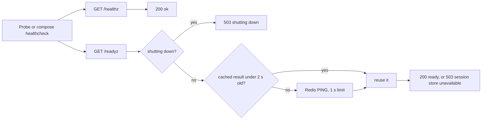

# #22 — Stage 12: observability (`22-stage-12-observability`)

**Status:** in progress. Step 12.1 is built, tested by you, committed and pushed. Step 12.2 is built and tested by you (see its "Test it yourself" section). Steps 12.3 to 12.5 are planned, nothing built. Plan: [docs/plans/stage-12-observability.md](../plans/stage-12-observability.md).

Stage 12 makes the server something you can **watch** (logs, health, metrics, traces) and something you can **stop cleanly**. Today its only window is plain text on stderr, with nothing that says which session a line belongs to.

## Steps at a glance

| Step | What it builds | Status |
|---|---|---|
| 12.1 | Structured logs: every line carries `req`, `session`, `sub` and `instance` | Built and tested by you; committed and pushed |
| 12.2 | `/healthz` and `/readyz` on an admin port, compose healthchecks | Built; 342 passed and 22 skipped without Redis, 364 of 364 with Redis; tested by you |
| 12.3 | `/metrics` with a fixed set of labels | Planned |
| 12.4 | OpenTelemetry traces | Planned |
| 12.5 | Graceful shutdown | Planned |

## 12.1 Structured logs with a session id

### What

- **`src/log.ts` (new):** one logger for the whole server. It has four levels (`debug`, `info`, `warn`, `error`), two formats (`text`, `json`) and a **request context**.
- **Three settings**, checked at startup like the others in `config.ts`:
  - `LOG_FORMAT` is `text` (default) or `json`.
  - `LOG_LEVEL` is `debug`, `info` (default), `warn` or `error`.
  - `INSTANCE_ID` names the instance in its lines. The default is the host name.
- **All 26 `console.error` calls** in the server now go through the logger: `http.ts` (13), `create-server.ts` (6), `auth/middleware.ts` (1), `review/index.ts` (3), `review/helpers/roots.ts` (1) and the stdio entry `index.ts` (2). The plan counted 20 and missed the last 6.
- **Tool-entry lines moved to `debug`.** The eight lines a tool writes when it starts (`add called with a=2, b=3`, `get_weather called with latitude=…`, `read_file <path>` and the rest) print arguments or paths, so they are off by default.
- **Audit lines carry `req`.** Their shape is otherwise unchanged, and they are still always printed.
- **Not changed:** `config.ts` startup errors and the issuer CLI keep their own `console.error` calls, as planned.

### Why

- With two instances and many clients, a line like `get_weather called with …` does not say whose call it was. You could not follow one session.
- The tool handler never receives the HTTP request, so it cannot be handed a session id by hand. The context carries it instead.
- The argument lines broke the audit log's own rule, "names only", because arguments can hold locations and file paths. At `debug` they are opt-in.

### How

**Request context.** Node has a built-in store, `AsyncLocalStorage` (`node:async_hooks`), that follows an async call: everything it awaits, every timer and promise chain it starts, can read the same value. No package is needed.

1. **The request middleware** in `http.ts` calls `runWithContext({ req })` with a fresh 8-character id and runs the rest of the request inside it.
2. **`handleStateful`** adds `session` as soon as it reads the `Mcp-Session-Id` header. For `initialize` there is no header, so it adds the id after the SDK has created it.
3. **`bearerAuth`** adds `sub` after the token check passes. The token itself is never stored in the context.
4. **Any `log.info(...)`**, however deep (a tool handler, the event store, the rebuild code), reads the context and adds `req`, `session` and `sub` to the line. An explicit field on the call wins over the context.

| Field | Where it comes from |
|---|---|
| `req` | the middleware, one per HTTP request |
| `session` | the `Mcp-Session-Id` header, or the new id for `initialize` |
| `sub` | the verified token, only when `AUTH_REQUIRED=1` |
| `instance` | `INSTANCE_ID`, or the host name |

**Why some lines pass `session` by hand.** `session X opened`, `closed`, `rebuilt`, `idle` and `could not save state` pass `{ session }` as an explicit field. They run from the SDK's callbacks, from `transport.onclose` and from the response stream, where I did not want to depend on the context reaching them.

**The two formats.** The message text is exactly what it was before, and the facts go next to it, so the things that match log text keep working (the test helper, `redis-sessions.test.ts`, `docker/kill-test.mjs`).

```
today:      [mcp-demo] session 3f1c9a opened (1 active)
text:       [mcp-demo] session 3f1c9a opened (1 active) req=7f3a9c21 session=3f1c9a instance=laptop
json:       {"time":"…","level":"info","instance":"laptop","req":"7f3a9c21","session":"3f1c9a","msg":"session 3f1c9a opened (1 active)"}
```

The session id appears twice in text mode, in the message and in `session=`. That is deliberate, so old readers keep working. Two start-up lines, `mcp-demo server running on …` and `Cannot reach Redis …`, never had the `[mcp-demo] ` prefix, so they keep going without it.

### Example, from a real run

One session on a temporary server with `LOG_FORMAT=json LOG_LEVEL=debug INSTANCE_ID=laptop`. `grep <session id>` on its log gives the whole session. Each request has its own `req`, and the `add` call has three lines that share one:

```
{"level":"info", "instance":"laptop","req":"d9fdf370","session":"9c08c463-…","msg":"session 9c08c463-… opened (1 active)"}
{"level":"info", "instance":"laptop","req":"d9fdf370","session":"9c08c463-…","msg":"POST /mcp 200 13ms"}
{"level":"info", "instance":"laptop","req":"dd055286","session":"9c08c463-…","msg":"POST /mcp 202 2ms"}
{"level":"debug","instance":"laptop","req":"75056613","session":"9c08c463-…","msg":"add called with a=2, b=3"}
{"level":"info", "instance":"laptop","req":"75056613","session":"9c08c463-…","msg":"POST /mcp 200 2ms"}
{"type":"audit","req":"75056613","sub":null,"session":"9c08c463-…","tool":"add","decision":"allowed","outcome":"ok","ms":0}
```

(Shortened here: the real lines also have a `time`, and the ids are longer.) With the default settings the same session prints today's lines plus the tail, and the `add called with` line is gone:

```
[mcp-demo] POST /mcp 200 2ms req=5f36f89d session=0d2ed697-… instance=laptop
```

### Proof

- **26 new tests:** 25 in [`test/log.test.ts`](../../packages/server/test/log.test.ts) and 1 in `config.test.ts`. 17 of the log tests need no server (formats, levels, the context across awaits and overlapping requests, `setContext`, errors). 8 start the real compiled server.
- **The spike worked.** The context survives the SDK for a `tools/call` over POST, for `initialize`, for events stored while a tool runs, for the `GET /mcp` replay stream, and for a session rebuilt on a second instance with Redis. The plan has the table.
- **Mutation checks.** Taking out the middleware's context made all 8 real-server tests fail. Taking out the session from the header made 5 fail, and taking out `sub` made 1 fail. Each file was restored from a copy and the checksums matched.
- **Compatibility.** The existing tests that read log text passed unchanged. The one that failed was the config test that lists every setting, because it now has three more, and I updated it.
- **Full suite:** 327 passed and 21 skipped without Redis, and 348 of 348 with a real Redis 7 (Docker).
- **By hand:** a server in JSON mode, then in text mode, then with `LOG_LEVEL=loud`, which exits with `Invalid configuration: LOG_LEVEL: must be debug, info, warn or error`.
- **The Docker kill test** (11.4) passed with the new build, so `docker/kill-test.mjs` still finds its lines. In the containers the instance name is the container id, because compose does not set `INSTANCE_ID` yet.

### Known limits

- **The audit lines are still always printed** and keep their own shape. `LOG_LEVEL=warn` does not hide them.
- **Not tested:** whether the context reaches lines written from the response-body stream (`afterBody`) or from `transport.onclose`. Those lines pass their session by hand, so they have it either way.
- **Per instance.** Each instance logs only what it did. Following a session across two instances means reading both logs, for example `docker compose logs server-a server-b | grep <session id>`.
- **Instance names in Docker.** The default is the host name, which is the container id. 12.2 sets `INSTANCE_ID` per server in the compose file, so the stack's lines now say `instance=server-a` and `instance=server-b`.
- **Text mode has no timestamp**, as before. JSON mode has `time`.
- **The 11.4 doc's expected line** `mcp-demo server running on http://localhost:4768/mcp (stateful)` is now the start of the line. It ends with ` instance=<name>`: the host name, or `server-a` and `server-b` in the Docker stack.
- **Level names.** `warn` and `error` appear in JSON as the `level` field. In text mode the level is not printed, as before.

### New packages

None. `node:async_hooks`, `node:crypto` and `node:os` are built into Node. Steps 12.3 and 12.4 add `prom-client` and the OpenTelemetry packages, and each is explained there.

### Test it yourself (12.1)

Use a terminal on Node 24 (`nvm use 24.22.2`) from the repo root. I ran all 11 steps myself; for the server steps I started `node build/http.js` directly, not `pnpm start:http`. You have also run all of them and they work.

1. Build:
   ```bash
   pnpm build
   ```
   If `packages/web` fails with an error and the server and client built, run it again. That intermittent failure is not from this change, and I have not found its cause.
2. Run the whole suite without Redis. Expect `Tests  327 passed | 21 skipped (348)`:
   ```bash
   pnpm test
   ```
3. Run it with Redis. Skip this if your own Redis is already on port 6379, and use that one. Expect `Tests  348 passed (348)`:
   ```bash
   docker run --rm -d --name mcp-test-redis -p 6379:6379 redis:7
   ```
   ```bash
   REDIS_URL=redis://localhost:6379 pnpm test
   ```
   ```bash
   docker stop mcp-test-redis
   ```
4. Run only the new and changed tests. Expect `Tests  42 passed | 1 skipped (43)` without Redis and `43 passed (43)` with it:
   ```bash
   pnpm exec vitest run packages/server/test/log.test.ts packages/server/test/config.test.ts
   ```
5. See the JSON format. Start a server in one terminal. A variable set in the shell beats `.env`, so this works with your own settings. The server's lines go to a file, so you can search them:
   ```bash
   MCP_SERVER_PORT=4785 AUTH_REQUIRED=0 SESSION_STORE=memory LOG_FORMAT=json LOG_LEVEL=debug INSTANCE_ID=laptop pnpm start:http 2> /tmp/mcp-12-1.log
   ```
6. In a second terminal, open a session and call `add`. `$SID` holds the session id:
   ```bash
   H=(-H 'content-type: application/json' -H 'accept: application/json, text/event-stream' -H 'Mcp-Protocol-Version: 2025-11-25')
   SID=$(curl -si -X POST localhost:4785/mcp "${H[@]}" -d '{"jsonrpc":"2.0","id":1,"method":"initialize","params":{"protocolVersion":"2025-11-25","capabilities":{},"clientInfo":{"name":"t","version":"1"}}}' | grep -i '^mcp-session-id:' | awk '{print $2}' | tr -d '\r'); echo $SID
   ```
   ```bash
   curl -s -o /dev/null -X POST localhost:4785/mcp "${H[@]}" -H "Mcp-Session-Id: $SID" -d '{"jsonrpc":"2.0","method":"notifications/initialized"}'
   ```
   ```bash
   curl -s -X POST localhost:4785/mcp "${H[@]}" -H "Mcp-Session-Id: $SID" -d '{"jsonrpc":"2.0","id":2,"method":"tools/call","params":{"name":"add","arguments":{"a":2,"b":3}}}'
   ```
7. Search the log for that one session. Expect JSON lines with `instance` `laptop`. The `add called with a=2, b=3` line is `debug`. It has the same `req` as the `POST /mcp 200` line after it and as the `"type":"audit"` line:
   ```bash
   grep "$SID" /tmp/mcp-12-1.log
   ```
   Stop the server with Ctrl+C when you are done.
8. See the default text format. Start the server again with no `LOG_FORMAT` or `LOG_LEVEL`, repeat step 6, and read the terminal. Expect lines like `[mcp-demo] POST /mcp 200 2ms req=5f36f89d session=… instance=…`, and **no** `add called with` line:
   ```bash
   MCP_SERVER_PORT=4785 AUTH_REQUIRED=0 SESSION_STORE=memory pnpm start:http
   ```
9. See the argument line come back. Add `LOG_LEVEL=debug` to the same command and repeat step 6. Expect `[mcp-demo] add called with a=2, b=3 req=… session=… instance=…`:
   ```bash
   LOG_LEVEL=debug MCP_SERVER_PORT=4785 AUTH_REQUIRED=0 SESSION_STORE=memory pnpm start:http
   ```
10. Check that a bad value stops the server. Expect `Invalid configuration:` then `- LOG_LEVEL: must be debug, info, warn or error`, and exit code 1:
    ```bash
    LOG_LEVEL=loud MCP_SERVER_PORT=4785 pnpm start:http
    ```
11. Check that the Docker stack still works with the new log lines. This needs `pnpm build` first (step 1). Expect six `PASS` lines and `KILL TEST PASSED`. It stays untested by you until you run it:
    ```bash
    docker compose -f docker/compose.scale.yml up -d --wait
    ```
    ```bash
    node docker/kill-test.mjs
    ```
    ```bash
    docker compose -f docker/compose.scale.yml down -v
    ```

## 12.2 Health and readiness

### What

- **`src/admin.ts` (new):** a second, small listener with two endpoints.
  - `GET /healthz` answers `200 {"status":"ok"}` as long as the process answers.
  - `GET /readyz` answers `200 {"status":"ready"}`, or `503 {"status":"not ready","reason":"…"}`. The reason is `shutting down` or `session store unavailable`.
- **Two settings**, checked at startup in `config.ts`:
  - `ADMIN_PORT` turns the listener on. **Unset, nothing listens.** It must differ from the MCP port, or the server refuses to start.
  - `ADMIN_HOST` is where it binds. The default is `127.0.0.1`, so only this machine can reach it.
- **Readiness asks Redis** when sessions live there: a `PING` that must answer within 1 second, reused for 2 seconds. With the memory store there is nothing to ask, so it is always ready.
- **Compose:** each server now has a healthcheck on its own `/readyz`, the proxy waits for both servers to be healthy, and each server has its own `INSTANCE_ID` (`server-a`, `server-b`).
- **Not changed:** the MCP port. `/healthz` and `/readyz` there answer `404`, as any unknown path does.

### Why

- **An orchestrator needs two different answers.**
  - "Should I restart this server?" is liveness, `/healthz`.
  - "Should I send it traffic?" is readiness, `/readyz`.
  - If liveness looked at Redis, a Redis outage would make the orchestrator restart every healthy server, which fixes nothing and makes it worse. So `/healthz` never asks Redis, and it stays `200` while the server shuts down. Failing it then would get the process killed in the middle of draining.
- **A separate port** (decision D6), because the MCP port carries the Origin, auth and rate-limit guards and sits behind the proxy. A probe should not need a token, and nothing meant for operators should be reachable through the proxy by accident. The cost is one more port.
- **The issuer is not a readiness check** (decision D7). Its keys are cached, so a short issuer outage does not stop tokens from being checked. If readiness depended on it, an issuer outage would take every instance out of rotation at once.
- **Instance names.** With two servers writing logs, `instance=server-a` is readable and a container id is not.

### How



1. **`createAdminApp`** builds a small Hono app from three things: a function that says whether shutdown has begun, a list of checks, and two timings. It knows nothing about Redis; `http.ts` passes the Redis check in. That is what makes it testable without a server.
2. **The Redis check** in `http.ts` is `redis.ping()` on the same client the session store uses. When Redis is away, that client fails the command at once (it does not queue it), so the probe does not wait.
3. **A check that fails, or takes over 1 second, counts as not ready.** The answer names the check (`session store unavailable`) and never the error, because a Redis error can contain the connection URL, which can hold a password.
4. **Probes that arrive together share one check**, and a result is reused for 2 seconds. A burst of probes cannot hammer Redis.
5. **Only a change of state is logged**, so a probe every 2 seconds does not fill the log:
   ```
   [mcp-demo] readiness: not ready (session store unavailable) instance=server-a
   [mcp-demo] readiness: ready again instance=server-a
   ```
   Probes to the admin port are not requests to the MCP app, so they are not in the request log either.
6. **If the admin port is taken**, the server prints `Cannot start the admin listener on 127.0.0.1:4771 (EADDRINUSE). Check ADMIN_PORT and ADMIN_HOST.` and exits with code 1. A server that silently has no health endpoint would look unhealthy to everything watching it.

**The compose healthcheck:**

```yaml
healthcheck:
  test: ["CMD", "wget", "-qO-", "http://127.0.0.1:4771/readyz"]
  interval: 2s
  timeout: 2s
  start_period: 30s
  retries: 3
```

- **It runs inside the container**, so `ADMIN_HOST` can stay `127.0.0.1` and the admin port needs no `ports:` entry. From your Mac and from other containers it is unreachable.
- **`wget` exits 1 on a `503`** as well as on a refused connection (I checked this in the `node:24.22.2-alpine` image), so "Redis is away" turns the server unhealthy. A `200` exits 0.
- **`start_period: 30s`** means failed probes in the first 30 seconds do not count, so a slow start is fine. After that, 3 failed probes in a row, about 6 seconds, mark the server unhealthy. The 11.4 value was `retries: 15` with no start period, which would have taken about 30 seconds to notice an outage.
- **The proxy** now has `depends_on` with `condition: service_healthy` for both servers, so it starts only when they can serve. `docker compose up -d --wait` returns when all five containers are healthy.
- **`INSTANCE_ID`** is set per server through a shared environment block. YAML's `<<` merge is shallow, so a service that sets its own `environment:` would replace the whole block. The file merges the shared block into each server's `environment:` instead.

### Example, from a real run

Local server with `ADMIN_PORT=4771`, memory store:

```
$ curl http://127.0.0.1:4771/healthz     {"status":"ok"} [200]
$ curl http://127.0.0.1:4771/readyz      {"status":"ready"} [200]
$ curl http://127.0.0.1:4785/healthz     [404]        (the MCP port)
$ curl http://127.0.0.1:4771/metrics     [404]        (12.3 adds it)
```

With a Redis container stopped and started again (the probe ran every 1.5 seconds):

```
19:29:47  readyz {"status":"ready"} [200]                                                   healthz {"status":"ok"} [200]
          --- docker stop
19:29:50  readyz {"status":"not ready","reason":"session store unavailable"} [503]          healthz {"status":"ok"} [200]
          --- docker start
19:29:55  readyz {"status":"not ready","reason":"session store unavailable"} [503]          healthz {"status":"ok"} [200]
19:29:57  readyz {"status":"ready"} [200]                                                   healthz {"status":"ok"} [200]
```

In the Docker stack, with Redis stopped, `docker compose ps` showed both servers `(unhealthy)` about 6 seconds later, and `(healthy)` again about 4 seconds after Redis started. Each server logged one `not ready` line and one `ready again` line.

### Proof

- **16 new tests:** 14 in [`test/admin.test.ts`](../../packages/server/test/admin.test.ts) and 2 in `config.test.ts`.
  - 10 test the admin app with no server: the three answers, a check that fails, hangs or recovers, the cache and the shared check, that the error text never reaches the answer or the log, and that only a change is logged.
  - 3 start the real compiled server: the endpoints on `ADMIN_PORT` and neither on the MCP port, no listener without `ADMIN_PORT`, and the exit when the port is taken.
  - 1 uses real Redis. It starts the server behind a small TCP forwarder ([`test/helpers/tcp-forwarder.ts`](../../packages/server/test/helpers/tcp-forwarder.ts)), cuts it, checks `/readyz` is `503` and `/healthz` is `200`, restores it, and checks `/readyz` is `200` again. It never touches the shared Redis. It is skipped without `REDIS_URL`.
- **Mutation checks.** Each break below made the test I expected fail, and the files were restored from a copy with matching checksums:
  - Ignoring the shutting-down flag failed 1 test.
  - Making `/healthz` depend on the checks failed 1.
  - Removing the cache failed 1.
  - Putting the error text in the answer failed 4.
  - Removing the listener's error handler failed the port-taken test.
  - Never asking Redis failed the real-Redis test.
- **A race in my own test.** Under parallel load the real-Redis test failed 3 times in about 36 runs: the helper returns when the MCP port is up, and the admin listener reports a moment later, so the first probe was refused. The tests now wait for the `admin endpoints on` line first, and 24 of 24 runs then passed under the same load.
- **Full suite:** 342 passed and 22 skipped without Redis, and 364 of 364 with Redis 7 (Docker).
- **By hand:**
  - The endpoints in memory mode, with the admin port bound to `127.0.0.1` only.
  - No listener without `ADMIN_PORT`.
  - `ADMIN_PORT` equal to the MCP port exits 1 with the config message, and a taken port exits 1 with the clear line.
  - Stateless mode with `ADMIN_HOST=0.0.0.0`, which listens on `*:4771`.
  - A dedicated Redis container stopped and started, as above.
- **In Docker:** the stack came up in about 7 seconds with `--wait`, both servers healthy. The admin port is not reachable from the host. The kill test passed (six `PASS` lines). Redis stopped and started made the servers unhealthy and healthy again, as above.

### Known limits

- **Shutdown is not graceful yet.** `/readyz` answers `503 shutting down` as soon as the shutdown flag is set, and a test proves it, but today `SIGTERM` exits right after closing the sessions, so you cannot watch it. The drain that makes it visible comes in 12.5.
- **Results are up to 2 seconds old.** Add up to 6 seconds in Docker before the healthcheck notices.
- **The proxy does not use `/readyz`.** Open-source nginx has no active health checks. The proxy waits for healthy servers only at startup, and afterwards relies on its own failed-connection skipping from 11.4. `/readyz` helps compose and an orchestrator.
- **The admin port has no auth, on purpose.** Bind it to `127.0.0.1`, or to a private network. `ADMIN_HOST=0.0.0.0` makes it reachable from anything that can reach the host, so keep that port off the public network. The answers hold only `ok`, `ready` and a short reason.
- **Order at start-up.** The admin listener reports after the MCP one. If its port is taken, the MCP server may already have printed `server running on …` before the process exits with code 1.
- **Stateless mode:** the listener works and I checked it by hand (`/readyz` `200`, `ADMIN_HOST=0.0.0.0`), but there is no automated test for it. The Redis check applies whenever `SESSION_STORE=redis`, because the server needs Redis at start-up in either mode.
- **The stdio server has no admin listener.** It has no port.
- **Not tested:** an IPv6 `ADMIN_HOST`. The log line writes it in brackets, but I did not run it.
- **`/metrics`** is a `404` until 12.3.

### New packages

None. The listener uses `hono` and `@hono/node-server`, which the MCP server already uses, and the Redis check uses the `ioredis` client from 11.2.

### Test it yourself (12.2)

Use two terminal tabs, on Node 24 (`nvm use 24.22.2`), from the repo root. I ran all of these steps myself (the server steps with `node build/http.js` directly, not `pnpm start:http`). You ran them too and they work.

1. Build:
   ```bash
   pnpm build
   ```
   If `packages/web` fails and the server and client built, run it again. That failure is intermittent and its cause is not found.
2. Run the whole suite without Redis. Expect `Tests  342 passed | 22 skipped (364)`:
   ```bash
   pnpm test
   ```
3. Run it with Redis. Skip starting one if your own Redis is already on port 6379. Expect `Tests  364 passed (364)`:
   ```bash
   docker run --rm -d --name mcp-test-redis -p 6379:6379 redis:7
   ```
   ```bash
   REDIS_URL=redis://localhost:6379 pnpm test
   ```
   ```bash
   docker stop mcp-test-redis
   ```
4. Run only the new and changed tests. Expect `Tests  33 passed | 1 skipped (34)` without Redis and `34 passed (34)` with it:
   ```bash
   pnpm exec vitest run packages/server/test/admin.test.ts packages/server/test/config.test.ts
   ```
5. **Tab 1:** start a server with the admin listener on. Expect two lines: `mcp-demo server running on http://localhost:4785/mcp (stateful) instance=<host>` and `[mcp-demo] admin endpoints on http://127.0.0.1:4771 (/healthz, /readyz) instance=<host>`:
   ```bash
   MCP_SERVER_PORT=4785 ADMIN_PORT=4771 AUTH_REQUIRED=0 SESSION_STORE=memory pnpm start:http
   ```
6. **Tab 2:** probe it. Expect `{"status":"ok"} [200]` and then `{"status":"ready"} [200]`:
   ```bash
   curl -s -w ' [%{http_code}]\n' http://127.0.0.1:4771/healthz
   ```
   ```bash
   curl -s -w ' [%{http_code}]\n' http://127.0.0.1:4771/readyz
   ```
7. **Tab 2:** check the MCP port does not serve them, and that `/metrics` is not there yet. Expect `404` three times:
   ```bash
   curl -s -o /dev/null -w '%{http_code}\n' http://127.0.0.1:4785/healthz
   ```
   ```bash
   curl -s -o /dev/null -w '%{http_code}\n' http://127.0.0.1:4785/readyz
   ```
   ```bash
   curl -s -o /dev/null -w '%{http_code}\n' http://127.0.0.1:4771/metrics
   ```
8. **Tab 2:** check where the admin port is bound. Expect `127.0.0.1:4771` and not `*:4771`:
   ```bash
   lsof -nP -iTCP:4771 -sTCP:LISTEN
   ```
   In tab 1, the two `404` lines for the MCP port are in the log, and the probes to the admin port are not.
9. **Tab 1:** press Ctrl+C, then start without `ADMIN_PORT`. Expect no `admin endpoints` line:
   ```bash
   MCP_SERVER_PORT=4785 AUTH_REQUIRED=0 SESSION_STORE=memory pnpm start:http
   ```
10. **Tab 2:** nothing should answer on the admin port. Expect `000`:
    ```bash
    curl -s -m 2 -o /dev/null -w '%{http_code}\n' http://127.0.0.1:4771/readyz
    ```
11. **Tab 1:** press Ctrl+C. Check that using the same port for both is refused. Expect `Invalid configuration:` then `- ADMIN_PORT: must differ from the MCP port (the admin listener is a separate port)`, and exit code 1:
    ```bash
    MCP_SERVER_PORT=4785 ADMIN_PORT=4785 pnpm start:http
    ```
    ```bash
    echo $?
    ```
12. **Tab 2:** make the admin port busy, and leave this running:
    ```bash
    node -e "require('net').createServer().listen(4771,'127.0.0.1')"
    ```
    **Tab 1:** start the server on it. Expect `Cannot start the admin listener on 127.0.0.1:4771 (EADDRINUSE). Check ADMIN_PORT and ADMIN_HOST.`, and exit code 1 (the MCP line may print first):
    ```bash
    MCP_SERVER_PORT=4785 ADMIN_PORT=4771 AUTH_REQUIRED=0 SESSION_STORE=memory pnpm start:http
    ```
    Then press Ctrl+C in tab 2 to free the port.
13. **Redis away and back, locally.** Start a separate Redis on port 6390, so yours on 6379 is not touched:
    ```bash
    docker run -d --name mcp-readyz-redis -p 6390:6379 redis:7
    ```
    **Tab 1:** start the server on it:
    ```bash
    MCP_SERVER_PORT=4785 ADMIN_PORT=4771 AUTH_REQUIRED=0 SESSION_STORE=redis REDIS_URL=redis://localhost:6390 pnpm start:http
    ```
    **Tab 2:** probe every 1.5 seconds, and leave it running. Expect `{"status":"ready"}`:
    ```bash
    while true; do date +%T; curl -s http://127.0.0.1:4771/readyz; echo; sleep 1.5; done
    ```
    **A third tab:** stop Redis. Within about 3 seconds tab 2 shows `{"status":"not ready","reason":"session store unavailable"}`:
    ```bash
    docker stop mcp-readyz-redis
    ```
    Start it again. Within about 4 to 8 seconds tab 2 shows `{"status":"ready"}` (it took about 4 in my run, because the client reconnects with a short backoff):
    ```bash
    docker start mcp-readyz-redis
    ```
    Tab 1 has exactly one `readiness: not ready (session store unavailable)` line and one `readiness: ready again` line. Then press Ctrl+C in tabs 1 and 2, and clean up:
    ```bash
    docker rm -f mcp-readyz-redis
    ```
14. **Docker: health.** Start the stack and wait. Expect `Healthy` for redis, issuer, server-a, server-b and proxy, in about 7 seconds:
    ```bash
    docker compose -f docker/compose.scale.yml up -d --wait
    ```
    ```bash
    docker compose -f docker/compose.scale.yml ps
    ```
    Expect `(healthy)` for server-a and server-b. The proxy has no healthcheck.
15. **Docker: the admin port is private.** From inside a server it answers. From your Mac it does not. Expect `{"status":"ready"}` and then `http 000` (if you have your own server on 4771, stop it first):
    ```bash
    docker compose -f docker/compose.scale.yml exec -T server-a wget -qO- http://127.0.0.1:4771/readyz
    ```
    ```bash
    curl -s -m 2 -o /dev/null -w 'http %{http_code}\n' http://127.0.0.1:4771/readyz
    ```
16. **Docker: instance names.** Expect `instance=server-a` and `instance=server-b` on the lines:
    ```bash
    docker compose -f docker/compose.scale.yml logs --no-log-prefix server-a server-b
    ```
17. **Docker: the kill test still passes.** Expect six `PASS` lines and `KILL TEST PASSED`:
    ```bash
    node docker/kill-test.mjs
    ```
18. **Docker: Redis away.** Stop it, wait about 8 seconds, and look. Expect both servers `(unhealthy)`:
    ```bash
    docker compose -f docker/compose.scale.yml stop redis
    ```
    ```bash
    docker compose -f docker/compose.scale.yml ps
    ```
    The `wget` command shows `HTTP/1.1 503`, so use `node` to see the body. Expect `503 {"status":"not ready","reason":"session store unavailable"}`:
    ```bash
    docker compose -f docker/compose.scale.yml exec -T server-a node -e "fetch('http://127.0.0.1:4771/readyz').then(async r => console.log(r.status, await r.text()))"
    ```
    `/healthz` is still `200`. Expect `{"status":"ok"}`:
    ```bash
    docker compose -f docker/compose.scale.yml exec -T server-a wget -qO- http://127.0.0.1:4771/healthz
    ```
19. **Docker: Redis back.** Start it, wait about 5 seconds, and look. Expect both servers `(healthy)` again, and one `not ready` and one `ready again` line per server:
    ```bash
    docker compose -f docker/compose.scale.yml start redis
    ```
    ```bash
    docker compose -f docker/compose.scale.yml ps
    ```
    ```bash
    docker compose -f docker/compose.scale.yml logs --no-log-prefix server-a server-b | grep "readiness:"
    ```
20. **Docker: clean up.** `-v` also removes the issuer key:
    ```bash
    docker compose -f docker/compose.scale.yml down -v
    ```

## Try it end to end

Steps 12.1 and 12.2 exist so far. This section grows with each step, and the full run-through comes with 12.5.

Use **two terminal tabs**, or three where a part says so. Tab 1 runs the server, on Node 24 (`nvm use 24.22.2`). Tab 2 sends requests with `curl`. Run every command from the repo root. Each part says which tab to use, what to type and what you should see, and names the matching steps in [Test it yourself (12.1)](#test-it-yourself-121) or [Test it yourself (12.2)](#test-it-yourself-122).

Parts 1 to 9 are 12.1 and 12.2: I ran them, and you ran them too and they work.

### Part 1: build and run the tests (12.1 steps 1 to 4)

1. **Tab 1:** build.
   ```bash
   pnpm build
   ```
   If `packages/web` fails and the server and client built, run it again. That failure is intermittent and its cause is not found.
2. **Tab 1:** run the suite. Expect `Tests  327 passed | 21 skipped (348)`. The skipped tests need Redis, and 12.1 step 3 runs them with Redis.
   ```bash
   pnpm test
   ```

### Part 2: the JSON format, and following one session (12.1 steps 5 to 7)

3. **Tab 1:** start the server with JSON logs and debug level. The `2>` at the end sends the server's log lines to the file `/tmp/mcp-12-1.log`, so tab 1 stays quiet. That is expected. The server writes to stderr and has no log-file setting; the file comes only from this redirect, and each run overwrites it.
   ```bash
   MCP_SERVER_PORT=4785 AUTH_REQUIRED=0 SESSION_STORE=memory LOG_FORMAT=json LOG_LEVEL=debug INSTANCE_ID=laptop pnpm start:http 2> /tmp/mcp-12-1.log
   ```
4. **Tab 2:** set the request headers once. Tab 2 keeps them for the later parts.
   ```bash
   H=(-H 'content-type: application/json' -H 'accept: application/json, text/event-stream' -H 'Mcp-Protocol-Version: 2025-11-25')
   ```
5. **Tab 2:** open a session. Expect `SID=[<a UUID>]`. Do not go on until it prints one. With an empty `SID`, the next requests get `400`, and `grep` in step 8 prints the whole file.
   ```bash
   SID=$(curl -si -X POST localhost:4785/mcp "${H[@]}" -d '{"jsonrpc":"2.0","id":1,"method":"initialize","params":{"protocolVersion":"2025-11-25","capabilities":{},"clientInfo":{"name":"t","version":"1"}}}' | grep -i '^mcp-session-id:' | awk '{print $2}' | tr -d '\r'); echo "SID=[$SID]"
   ```
   If it prints `SID=[]`, run the same request without the pipe to see the raw response:
   ```bash
   curl -si -X POST localhost:4785/mcp "${H[@]}" -d '{"jsonrpc":"2.0","id":1,"method":"initialize","params":{"protocolVersion":"2025-11-25","capabilities":{},"clientInfo":{"name":"t","version":"1"}}}'
   ```
6. **Tab 2:** send the handshake. It prints nothing.
   ```bash
   curl -s -o /dev/null -X POST localhost:4785/mcp "${H[@]}" -H "Mcp-Session-Id: $SID" -d '{"jsonrpc":"2.0","method":"notifications/initialized"}'
   ```
7. **Tab 2:** call `add`. Expect an event containing `"text":"5"`.
   ```bash
   curl -s -X POST localhost:4785/mcp "${H[@]}" -H "Mcp-Session-Id: $SID" -d '{"jsonrpc":"2.0","id":2,"method":"tools/call","params":{"name":"add","arguments":{"a":2,"b":3}}}'
   ```
8. **Tab 2:** search the log for that one session.
   ```bash
   grep "$SID" /tmp/mcp-12-1.log
   ```
   Expect six JSON lines, each with `session` set to your id and `instance` set to `laptop`:
   - `session … opened (1 active)` and `POST /mcp 200`, the `initialize` call, with one `req`.
   - `POST /mcp 202`, the handshake, with its own `req`.
   - `add called with a=2, b=3`, at level `debug`.
   - The audit line, with `"type":"audit"` and `"tool":"add"`.
   - `POST /mcp 200`, the `add` call.

   The last three lines share one `req`. That is how one call is tied together. To watch lines arrive live, run `tail -f /tmp/mcp-12-1.log` in a third tab.
9. **Tab 1:** press Ctrl+C to stop the server.

### Part 3: the default text format (12.1 step 8)

10. **Tab 1:** start the server with no `LOG_FORMAT`, `LOG_LEVEL` or `2>`, so the lines print in the terminal.
    ```bash
    MCP_SERVER_PORT=4785 AUTH_REQUIRED=0 SESSION_STORE=memory pnpm start:http
    ```
11. **Tab 2:** repeat steps 5, 6 and 7. Do not repeat step 4, because `H` is still set. Run step 5 again, because the restarted server needs a new session.
12. **Tab 1:** read the lines. Expect the text before `req=` to match what the server printed before 12.1, and a `key=value` tail added. `instance` is your machine's hostname, because `INSTANCE_ID` is not set:
    ```
    [mcp-demo] session 548b73ac-… opened (1 active) req=fff1719d session=548b73ac-… instance=<hostname>
    [mcp-demo] POST /mcp 200 14ms req=fff1719d session=548b73ac-… instance=<hostname>
    [mcp-demo] POST /mcp 202 2ms req=157cd27a session=548b73ac-… instance=<hostname>
    {"type":"audit",…,"tool":"add","outcome":"ok",…}
    [mcp-demo] POST /mcp 200 3ms req=58100fc1 session=548b73ac-… instance=<hostname>
    ```
    There is **no** `add called with` line, because it is a `debug` line and the default level is `info`. Two lines look different: the startup line has no `[mcp-demo]` prefix, and the audit line is always JSON.
13. **Tab 1:** press Ctrl+C. Expect `session … closed (0 active)`, with `session=` but no `req=`, because no request is running at shutdown.

### Part 4: the debug level (12.1 step 9)

14. **Tab 1:** start the server at debug level.
    ```bash
    LOG_LEVEL=debug MCP_SERVER_PORT=4785 AUTH_REQUIRED=0 SESSION_STORE=memory pnpm start:http
    ```
15. **Tab 2:** repeat steps 5, 6 and 7 (a new session again).
16. **Tab 1:** expect one extra line, before the audit line, with the same `req` as the audit line and the final `POST /mcp 200`:
    ```
    [mcp-demo] add called with a=2, b=3 req=fd38482e session=0a049ae1-… instance=<hostname>
    ```
    Tool arguments such as latitudes, operands and file paths can be sensitive, so they print only when you ask for `debug` (decision D2).
17. **Tab 1:** press Ctrl+C.

### Part 5: a bad setting stops the server (12.1 step 10)

18. **Tab 1:** start the server with an invalid level.
    ```bash
    LOG_LEVEL=loud MCP_SERVER_PORT=4785 pnpm start:http
    ```
    Expect `Invalid configuration:` and then `- LOG_LEVEL: must be debug, info, warn or error`. The server does not stay up.
19. **Tab 1:** check the exit code. Expect `1`.
    ```bash
    echo $?
    ```

### Part 6: the Docker stack still works (12.1 step 11)

Several things outside the server's own tests read log text, and the kill test is the main one. This part shows that 12.1 did not break the messages it looks for. Docker must be running.

20. **Tab 1:** build. Skip this if you built in step 1 and changed nothing since.
    ```bash
    pnpm build
    ```
21. **Tab 1:** start the five containers (Redis, issuer, two servers and the proxy) and wait until they are healthy.
    ```bash
    docker compose -f docker/compose.scale.yml up -d --wait
    ```
22. **Tab 1:** run the kill test. Expect six `PASS` lines and `KILL TEST PASSED`.
    ```bash
    node docker/kill-test.mjs
    ```
23. **Tab 1:** remove everything, including the issuer key volume.
    ```bash
    docker compose -f docker/compose.scale.yml down -v
    ```

In Docker, `instance=` is `server-a` or `server-b`, because 12.2 sets `INSTANCE_ID` per server in the compose file. Before 12.2 it was the container id.

### Part 7: the admin listener (12.2 steps 5 to 12)

This part needs the build from step 1. Use tab 1 for the server and tab 2 for `curl`.

24. **Tab 1:** start a server with the admin listener on. The two lines to look for are the usual `server running on` line and `admin endpoints on http://127.0.0.1:4771 (/healthz, /readyz)`.
    ```bash
    MCP_SERVER_PORT=4785 ADMIN_PORT=4771 AUTH_REQUIRED=0 SESSION_STORE=memory pnpm start:http
    ```
25. **Tab 2:** ask the two questions. Expect `{"status":"ok"} [200]` and `{"status":"ready"} [200]`. `/healthz` means "the process answers", and `/readyz` means "send me traffic".
    ```bash
    curl -s -w ' [%{http_code}]\n' http://127.0.0.1:4771/healthz
    ```
    ```bash
    curl -s -w ' [%{http_code}]\n' http://127.0.0.1:4771/readyz
    ```
26. **Tab 2:** ask the MCP port the same questions. Expect `404` for both. The probes belong on the admin port only:
    ```bash
    curl -s -o /dev/null -w '%{http_code}\n' http://127.0.0.1:4785/healthz
    ```
    ```bash
    curl -s -o /dev/null -w '%{http_code}\n' http://127.0.0.1:4785/readyz
    ```
27. **Tab 2:** see where the admin port is bound. Expect `127.0.0.1:4771`, not `*:4771`, so only this machine can reach it:
    ```bash
    lsof -nP -iTCP:4771 -sTCP:LISTEN
    ```
    In tab 1 you now see two `GET … 404` lines for the MCP port, and no line for the admin probes. The admin port is a separate app with no request log.
28. **Tab 1:** press Ctrl+C, then start the server without `ADMIN_PORT`. Expect no `admin endpoints` line:
    ```bash
    MCP_SERVER_PORT=4785 AUTH_REQUIRED=0 SESSION_STORE=memory pnpm start:http
    ```
29. **Tab 2:** confirm nothing listens on the admin port. Expect `000`:
    ```bash
    curl -s -m 2 -o /dev/null -w '%{http_code}\n' http://127.0.0.1:4771/readyz
    ```
30. **Tab 1:** press Ctrl+C, then try the same port for both. Expect `Invalid configuration:` and `- ADMIN_PORT: must differ from the MCP port (the admin listener is a separate port)`, and then exit code `1`:
    ```bash
    MCP_SERVER_PORT=4785 ADMIN_PORT=4785 pnpm start:http
    ```
    ```bash
    echo $?
    ```
31. **Tab 2:** make the admin port busy, and leave it running:
    ```bash
    node -e "require('net').createServer().listen(4771,'127.0.0.1')"
    ```
    **Tab 1:** start the server on that port. Expect `Cannot start the admin listener on 127.0.0.1:4771 (EADDRINUSE). Check ADMIN_PORT and ADMIN_HOST.` and exit code `1`. The `server running on` line may print first.
    ```bash
    MCP_SERVER_PORT=4785 ADMIN_PORT=4771 AUTH_REQUIRED=0 SESSION_STORE=memory pnpm start:http
    ```
    Press Ctrl+C in tab 2 to free the port.

### Part 8: Redis goes away and comes back (12.2 step 13)

This shows readiness changing while the process stays healthy. It uses a separate Redis on port 6390, so yours on 6379 is not touched. You need three tabs.

32. **Any tab:** start the separate Redis:
    ```bash
    docker run -d --name mcp-readyz-redis -p 6390:6379 redis:7
    ```
33. **Tab 1:** start the server on it, with the admin listener:
    ```bash
    MCP_SERVER_PORT=4785 ADMIN_PORT=4771 AUTH_REQUIRED=0 SESSION_STORE=redis REDIS_URL=redis://localhost:6390 pnpm start:http
    ```
34. **Tab 2:** probe every 1.5 seconds, and leave it running. Expect `{"status":"ready"}` for now:
    ```bash
    while true; do date +%T; curl -s http://127.0.0.1:4771/readyz; echo; sleep 1.5; done
    ```
35. **Tab 3:** stop Redis. Within about 3 seconds tab 2 changes to `{"status":"not ready","reason":"session store unavailable"}`. The server does not crash, and `/healthz` stays `200`:
    ```bash
    docker stop mcp-readyz-redis
    ```
    ```bash
    curl -s -w ' [%{http_code}]\n' http://127.0.0.1:4771/healthz
    ```
36. **Tab 3:** start Redis again. Within about 4 to 8 seconds tab 2 goes back to `{"status":"ready"}`:
    ```bash
    docker start mcp-readyz-redis
    ```
    Tab 1 has one `readiness: not ready (session store unavailable)` line and one `readiness: ready again` line, however many probes ran. Press Ctrl+C in tabs 1 and 2, then clean up:
    ```bash
    docker rm -f mcp-readyz-redis
    ```

### Part 9: the Docker stack, healthy and unhealthy (12.2 steps 14 to 20)

Docker must be running, and the build from step 1 must be current. Use one tab.

37. **Start the stack and wait for health.** Expect `Healthy` for redis, issuer, server-a, server-b and proxy, in about 7 seconds. The proxy starts only after both servers are healthy:
    ```bash
    docker compose -f docker/compose.scale.yml up -d --wait
    ```
38. **List the containers.** Expect `(healthy)` for server-a and server-b:
    ```bash
    docker compose -f docker/compose.scale.yml ps
    ```
39. **Check the admin port is private.** From inside a server it answers. From your Mac it does not (stop your own server on 4771 first, if you have one). Expect `{"status":"ready"}` and then `http 000`:
    ```bash
    docker compose -f docker/compose.scale.yml exec -T server-a wget -qO- http://127.0.0.1:4771/readyz
    ```
    ```bash
    curl -s -m 2 -o /dev/null -w 'http %{http_code}\n' http://127.0.0.1:4771/readyz
    ```
40. **Read the logs.** Expect `instance=server-a` and `instance=server-b`, and an `admin endpoints on` line for each:
    ```bash
    docker compose -f docker/compose.scale.yml logs --no-log-prefix server-a server-b
    ```
41. **Run the kill test.** Expect six `PASS` lines and `KILL TEST PASSED`:
    ```bash
    node docker/kill-test.mjs
    ```
42. **Take Redis away.** After about 8 seconds, expect both servers `(unhealthy)`:
    ```bash
    docker compose -f docker/compose.scale.yml stop redis
    ```
    ```bash
    docker compose -f docker/compose.scale.yml ps
    ```
43. **Look at the answers inside a server.** `wget` only says `HTTP/1.1 503`, so use `node` for the body. Expect `503 {"status":"not ready","reason":"session store unavailable"}`, and then `{"status":"ok"}` from `/healthz`:
    ```bash
    docker compose -f docker/compose.scale.yml exec -T server-a node -e "fetch('http://127.0.0.1:4771/readyz').then(async r => console.log(r.status, await r.text()))"
    ```
    ```bash
    docker compose -f docker/compose.scale.yml exec -T server-a wget -qO- http://127.0.0.1:4771/healthz
    ```
44. **Bring Redis back.** After about 5 seconds, expect both servers `(healthy)` again, and one `not ready` and one `ready again` line per server:
    ```bash
    docker compose -f docker/compose.scale.yml start redis
    ```
    ```bash
    docker compose -f docker/compose.scale.yml ps
    ```
    ```bash
    docker compose -f docker/compose.scale.yml logs --no-log-prefix server-a server-b | grep "readiness:"
    ```
45. **Clean up.** `-v` also removes the issuer key:
    ```bash
    docker compose -f docker/compose.scale.yml down -v
    ```
