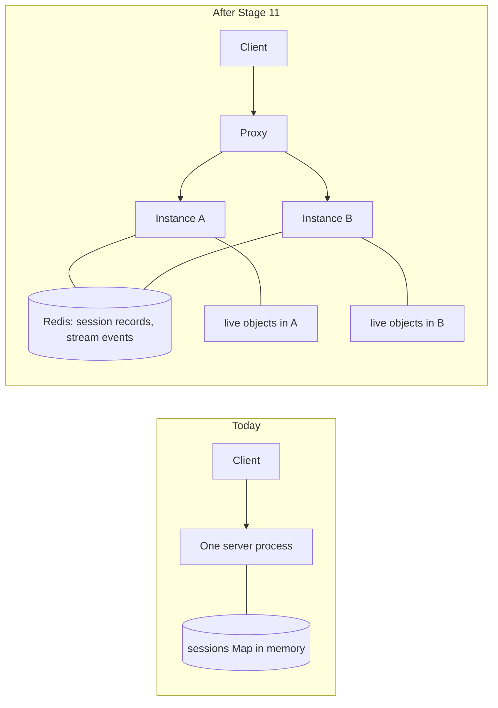
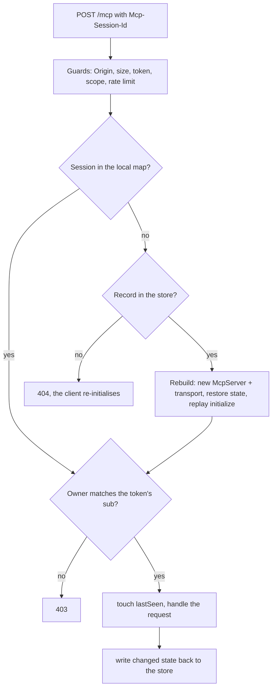
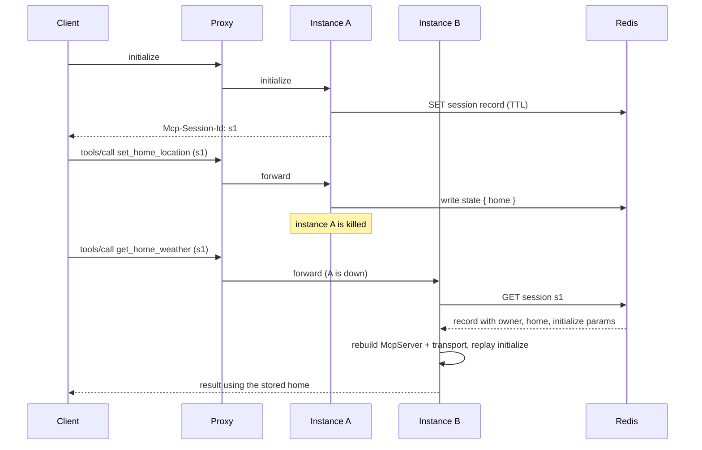

# Plan: Stage 11, persistence and scaling

**Phase 2, stage 3 of 5.** Branch: `21-stage-11-persistence-scaling` (cut from `main` after PR 20 merges). Status: planned.

## Goal

Today a stateful session lives only in one process's memory. Restart the server and every session is gone; start a second instance and a client's session id works on only one of them. Stage 11 moves the part of a session that can move into a shared store (Redis), so a restart or a second instance does not lose it, and lets a dropped stream resume with `Last-Event-ID`.

## You can do this when it's done

Start two server instances and a proxy in front, connect a client, and call a tool. Kill the instance that answered. The client's next call, with the same `Mcp-Session-Id`, is answered by the other instance and still sees the session's state (for example the home location set by `set_home_location`). Cut a streaming call's connection and reconnect with `Last-Event-ID`: the events after that id arrive again.

## 1. What is Stage 11?

Stage 11 makes the HTTP server's **sessions** survive two things that break them today: a restart, and a second copy of the server.

- **Session:** created when a client calls `initialize`; the client then sends `Mcp-Session-Id` on every request. Today it lives in one process's memory.
- **Persistence:** the plain-data part of a session (owner, `home`, timestamps, the client's `initialize` parameters) is written to a shared store, Redis.
- **Scaling:** any instance that gets a session id it does not hold in memory looks it up in the store and **rebuilds** the live objects. So a load balancer can send a client's requests to any instance.
- **Resumability:** the SDK's `EventStore` keeps the events of each SSE stream, so a client that loses its connection reconnects with `Last-Event-ID` and gets the missed events again.
- **Not in this stage:** Docker for production, TLS, health checks and metrics (Stages 12 and 13), and Redis high availability.

Key terms:

| Term | Meaning here |
|---|---|
| Stateful session | A session with an id, an owner and per-session tool state (`set_home_location`) |
| Store | Where the session's data lives: memory (today) or Redis |
| Rebuild | Creating a new `McpServer` and transport from a stored record |
| Resumability | Replaying stream events after `Last-Event-ID` |
| Sticky routing | The proxy always sends one session to the same instance (fallback B, not the plan) |

## 2. Why is it needed?

| Problem today | What happens | Stage 11 fix |
|---|---|---|
| The server restarts (deploy, crash) | Every client's session is gone; the next call gets `404` and `home` is lost | The record is in Redis, so the same session id still works |
| You run two instances for load or availability | A session id works on the instance that made it and gets `404` on the other | Either instance rebuilds the session from the store |
| A client's SSE connection drops mid-call | Events sent during the gap are lost | The event store replays them after `Last-Event-ID` |
| Sessions only exist in memory | Memory grows with sessions and cannot be shared or inspected | The store owns the data, with expiry |

**Where it sits in the architecture.** Phase 2 is "make it production-ready". Stages 9 and 10 made the server safe to expose; Stage 11 makes it safe to *run* (restart it, scale it); Stage 12 lets you see it; Stage 13 ships it. Without 11, Stage 13's two-instance deployment would break stateful clients.

**What it does not change.** Stateless mode (no sessions) already scales and stays as it is (D7). stdio has no sessions. The default store stays in memory, so a laptop run is exactly as before.

## Starting point (already built)

- `http.ts` keeps `sessions: Map<id, Session>`. A `Session` holds a live `McpServer`, a live transport, a `SessionState` (`{ home? }`), `lastSeen` and `owner` (the `sub`).
- `sweepIdleSessions` closes sessions idle past `MCP_SESSION_TTL_MS`.
- Stateless mode already scales horizontally but has no sessions, no `GET` stream and no per-session state.
- The SDK transport has an `eventStore` option and an `EventStore` interface (`storeEvent`, `replayEventsAfter`) for resumability. I read this in `webStandardStreamableHttp.d.ts` (SDK 1.32.2). I have **not** run it.
- `config.ts` validates every HTTP setting at startup (10.5), so new settings go there.

## The hard part (read this first)

A session is two things:

| Part | Can it move to a store? |
|---|---|
| **Data**: owner, `home`, created and last-seen times, the client's `initialize` parameters | Yes, it is plain JSON |
| **Live objects**: the `McpServer`, the transport, open SSE streams, a tool call that is running | No. They are in-process and cannot be serialised |

So "persistence" means: store the data, and **rebuild** the live objects on whichever instance receives the request. Whether a rebuilt transport accepts a session id it never issued was the open question. The 11.1 spike answered it: yes, by replaying `initialize` with a generator that returns the stored id (D1 A).

## Decisions

| # | Decision | Proposal | Status |
|---|---|---|---|
| D1 | How another instance takes over a session | **A**: on a store hit with no local session, build a new `McpServer` and transport, restore the data, and replay the stored `initialize` so the SDK treats it as initialised. **B** (fallback if A fails the 11.1 spike): the proxy sticks a session to one instance by `Mcp-Session-Id`, and a dead instance's sessions answer `404` so the client re-initialises (our clients already do). B loses the live session, but not the data a new session would not need | **decided: A.** The 11.1 spike passed (`test/session-rebuild.test.ts`): a second instance with `sessionIdGenerator: () => storedId` replays `initialize` and `notifications/initialized` through the public API, then answers `tools/call` for the old id. No private SDK field is used. B stays as the fallback |
| D2 | Which store | Redis, behind a `SessionStore` interface with an in-memory implementation (the default, today's behaviour) and a Redis one. `SESSION_STORE=memory\|redis`, `REDIS_URL` | proposed |
| D3 | Redis client | `ioredis` | proposed, unchecked against current docs |
| D4 | Idle timeout with Redis | The Redis key expires after `MCP_SESSION_TTL_MS` and each request refreshes it, so the sweeper is only needed for the memory store | proposed |
| D5 | Rate limit buckets (10.3) | Stay per instance, and the doc says so. Moving them to Redis is optional and only if time allows | proposed |
| D6 | Redis in tests and CI | The store contract tests run against memory always, and against Redis when `REDIS_URL` is set. CI gets a Redis service container. Local runs without Redis skip those tests, loudly | proposed |
| D7 | Stateless mode | Unchanged | decided |

## Steps

**11.1 Session store interface (and the spike). (built)**
First, a throwaway test that builds a second transport, sets the session id, replays `initialize` and answers a `tools/call`. The result picks D1 A or B and is recorded here. Then `SessionStore` (`get`, `set`, `touch`, `delete`) over a plain `SessionRecord` (`id`, `owner`, `state`, `initializeParams`, `createdAt`, `lastSeen`), an in-memory implementation, and `http.ts` using it for the data while the live objects stay in the local map.
*Files:* `src/session-store.ts` (new), `src/http.ts`, `test/session-store.test.ts` (new).
*Done when:* behaviour is unchanged (all existing tests pass; 242 with the new ones), the store has contract tests, and the D1 result is written in this plan.

**11.2 Redis store.**
A Redis implementation of the same interface, with key expiry (D4). New settings `SESSION_STORE`, `REDIS_URL` in `config.ts`, with the usual startup validation (`redis` needs `REDIS_URL`; the message never prints the URL, which can hold a password). On a miss in the local map, `handleStateful` asks the store and, per D1, rebuilds. After each request that may change `state`, write it back to the store (see "Gap found while planning").
*Files:* `src/session-store-redis.ts` (new), `src/config.ts`, `src/http.ts`, `package.json` (`ioredis`), tests, `.env.example`.
*Done when:* the same contract tests pass against Redis, and a test restarts the server process and the session id still works with its `home` intact.

**11.3 Resumable streams.**
An `EventStore` (memory and Redis) passed to the transport, so events are stored per stream and replayed after `Last-Event-ID`. Bounded: a maximum number of events per stream and an expiry, set in config.
*Files:* `src/event-store.ts` (new), `src/http.ts`, `src/config.ts`, tests.
*Done when:* a test opens a stream, drops it, reconnects with `Last-Event-ID` and receives exactly the later events, with the store capped as configured.

**11.4 Two instances behind a proxy.**
A `docker-compose` file with Redis, two server instances and a small proxy (nginx or Caddy), with no SSE buffering. A script (or test) kills one instance mid-session. The proxy config is the start of Stage 13's gateway work, so keep it minimal.
*Files:* `docker/compose.scale.yml`, `docker/proxy.conf`, an end-to-end script, docs.
*Done when:* the kill test passes: the session id keeps working and its state is intact.

Then the branch doc (ending with **Try it end to end**, per `constitution/planning.md`), the README row and the roadmap page.

## 3. How do we implement it?

### Architecture, today and after



Redis holds only data. Each instance keeps its own live objects for the sessions it has served.

### What one request does after Stage 11



### Failover, step by step



### The stored record

One Redis key per session, for example `mcp:session:<id>`, holding the JSON of `SessionRecord` (already defined in `src/session-store.ts`):

```json
{
  "id": "3f1c…",
  "owner": "alice",
  "state": { "home": { "name": "Dubai", "lat": 25.2, "lon": 55.3 } },
  "initializeParams": { "protocolVersion": "…", "clientInfo": { "name": "cursor" }, "capabilities": {} },
  "createdAt": 1790000000000,
  "lastSeen": 1790000600000
}
```

Planned Redis operations (unverified until 11.2): `SET key json PX <ttl>` to create, `GET` to read, `PEXPIRE` on every request (D4), `DEL` on close.

### Components and files

| Component | New or changed | Job |
|---|---|---|
| `src/session-store.ts` | built in 11.1 | `SessionRecord`, `SessionStore`, `MemorySessionStore` |
| `src/session-store-redis.ts` | new in 11.2 | Same interface on Redis, with expiry |
| `src/config.ts` | 11.2, 11.3 | `SESSION_STORE`, `REDIS_URL`, event-store limits, validated at startup |
| `src/http.ts` | 11.1 built, 11.2 and 11.3 | Local map plus store; rebuild on a store hit; write state back; pass `eventStore` |
| `src/event-store.ts` | new in 11.3 | Memory and Redis `EventStore` for `Last-Event-ID` replay |
| `docker/compose.scale.yml`, `docker/proxy.conf` | new in 11.4 | Redis, two instances, a proxy with no SSE buffering |

### Dependencies

| Dependency | Needed for | Status |
|---|---|---|
| `ioredis` | Redis client (D3) | not installed; check current docs and the Node 22/24 fit at 11.2 |
| Redis server | the store | not installed here; run it in Docker for tests and 11.4 |
| Docker | 11.4 and CI's Redis service | `docker` is installed locally; I have not run it |
| nginx or Caddy | the proxy in 11.4 | to be chosen; SSE buffering off is the only hard requirement |
| MCP SDK `eventStore` option | 11.3 | present in SDK 1.32.2 types; not run |

### Gap found while planning: state is written only at creation

In 11.1, `http.ts` calls `store.set(...)` once, when the session opens. `state` is a mutable object that tools change (`set_home_location`), and the memory store holds the same object, so memory works. Redis holds a copy, so **11.2 must write the state back after each request that may change it** (compare the JSON before and after, and `set` only on change). Without that, a failover would restore the `home` from creation time, and the Stage 11 "done" demo would fail.

## 4. How do we integrate it without breaking what exists?

| Existing piece | Effect of Stage 11 | How it stays safe |
|---|---|---|
| Stage 9 token check | None; it runs before the session code | A request with a valid session id and no token still gets `401` (test exists) |
| Stage 10 scopes and session owner | The owner moves into the record, so it survives a restart | The `403` for another caller's token is tested against the store too |
| Stage 10 rate limit | Stays per instance (D5) | Documented; two instances allow twice the rate |
| Stage 10 audit log | Unchanged; each instance writes its own stderr | Stage 12 collects logs |
| Stage 10.5 config | New settings validated at startup | `redis` without `REDIS_URL` fails fast; the message never prints the URL |
| Idle sweeper | Memory store: as today. Redis: the key expires. Each instance still closes its own idle live objects | Sweeper tests keep running against the memory store |
| Stateless mode and stdio | Untouched (D7) | Their tests are unchanged |

**Order of work keeps the server shippable at every step.** 11.1 changed no behaviour (242 tests pass). 11.2 is opt-in with `SESSION_STORE=redis`; the default stays memory. 11.3 adds the event store behind a setting. 11.4 is only a compose file and a script.

**Rollback.** Set `SESSION_STORE=memory` (the default) and the server behaves like Stage 10.

### Testing strategy

| Level | What | How |
|---|---|---|
| Contract | `SessionStore`: set, get, touch, delete, missing id, expiry | One suite, run against memory always and Redis when `REDIS_URL` is set (D6) |
| Spike (built) | A second instance adopts a session id it never issued | `test/session-rebuild.test.ts` |
| Integration | Restart: stop the compiled server, start it again, same session id and `home` | End-to-end test in `http.test.ts` style, Redis only |
| Integration | Two server processes, one Redis: call on A, call the same session on B | Real compiled servers on spare ports |
| Resume | Open a stream, drop it, reconnect with `Last-Event-ID`, get only the later events; cap and expiry enforced | Event-store tests plus one end-to-end test |
| Failure | Redis down at startup (exit 1, clear message) and while running (`503` with `Retry-After`) | Start with a bad URL; stop Redis mid-test |
| Security | The stored owner still blocks another caller's token | Reuse the Stage 10 owner test against the Redis store |
| Mutation | Remove the state write-back, the owner check, or the `touch` | The matching test must fail, then restore |
| Compose | Kill one instance mid-session | The 11.4 script; the "done when" |

CI: add a Redis service container and set `REDIS_URL`, so the Redis tests run there. Locally without Redis they skip with a visible message.

### Practical example, from clean start

1. `docker compose -f docker/compose.scale.yml up` starts Redis, instances A and B, and the proxy.
2. A client connects through the proxy, calls `set_home_location` ("Dubai"), and gets session `s1`.
3. `docker compose stop server-a` kills the instance that answered.
4. The client calls `get_home_weather` with `s1`. Instance B rebuilds `s1` from Redis and answers with Dubai.
5. The client calls with a made-up id and gets `404`.

This is the shape of 11.4's end-to-end test. Nothing here has been run yet.

## Behaviour table (the proof)

| Situation | Answer |
|---|---|
| Restart the only instance, then call with the old session id | works, state intact (store hit, objects rebuilt) |
| Second instance gets a session id it never saw | works (store hit) |
| Session id not in the store (expired or never existed) | `404`, the client re-initialises |
| Another caller's token with a stored session id | `403` (the owner comes from the store) |
| Redis down at startup with `SESSION_STORE=redis` | the server does not start, the message says why |
| Redis goes down while running | requests that need the store get `503` with `Retry-After`, nothing else breaks |
| Stream dropped, reconnect with `Last-Event-ID` | later events replayed |
| `Last-Event-ID` older than the retained events | replay from the oldest retained, and the doc says events may be missing |

## Risks

- **D1 may fail.** The SDK may not let a rebuilt transport adopt a session id. That is why 11.1 starts with a spike and has fallback B.
- **A running tool call dies with its instance.** Resumability only replays events that were stored. The result of a call that was mid-run when the instance died is lost, and the client has to call again.
- **Cancel across instances.** `notifications/cancelled` for a call running on instance A, sent to instance B, does not reach it. Same family as the cancel limit already noted for stateless mode.
- **Per-session state is tiny today** (`home` only). A rebuilt session is only as faithful as what the record stores, so anything new added to `SessionState` must be added to the record.
- **Redis is now a dependency.** A new thing that can be down, and one more secret (`REDIS_URL`).
- **Rate limits per instance (D5).** Two instances each allow the full rate.
- **Not run yet:** nothing in this plan has been tried, including Redis commands and `ioredis` usage. Treat library details as unverified until 11.2.

## Out of scope

Redis clustering and high availability, running Redis for production (Stage 13), distributed locking, migrating sessions between store types, metrics on the store (Stage 12), and the gateway's TLS and routing rules beyond the minimal proxy in 11.4.
