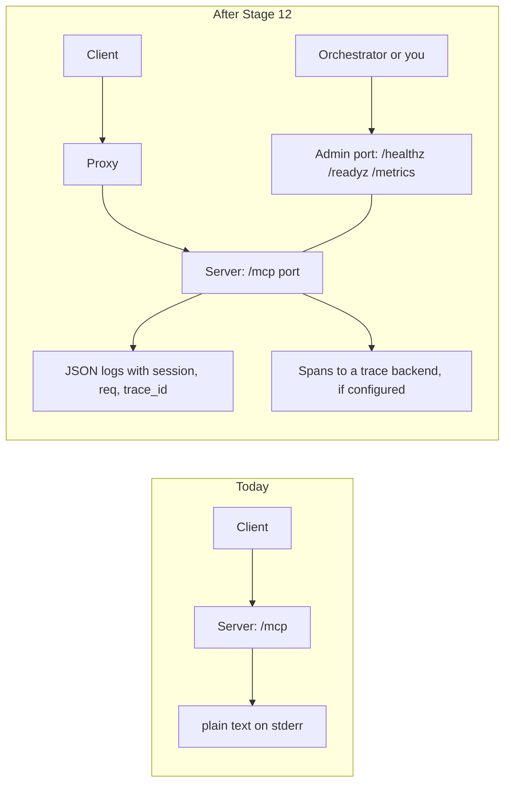
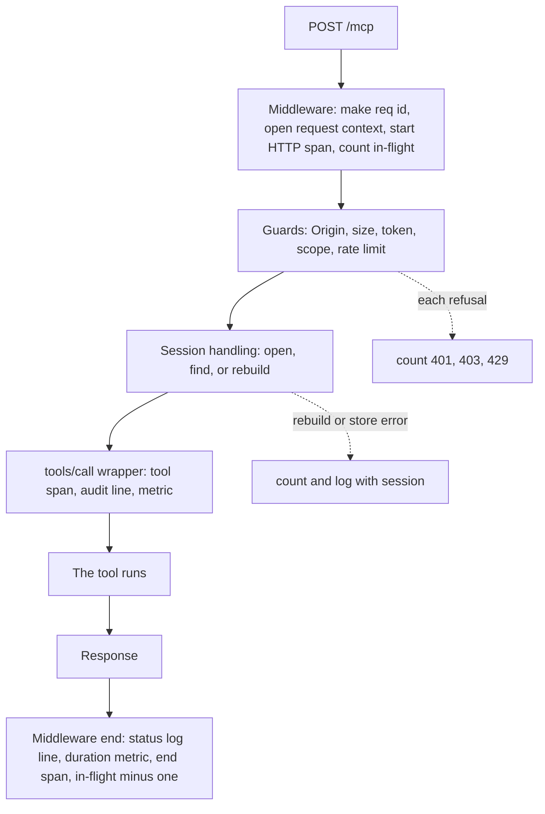
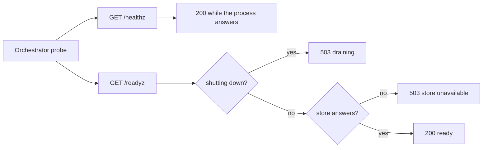
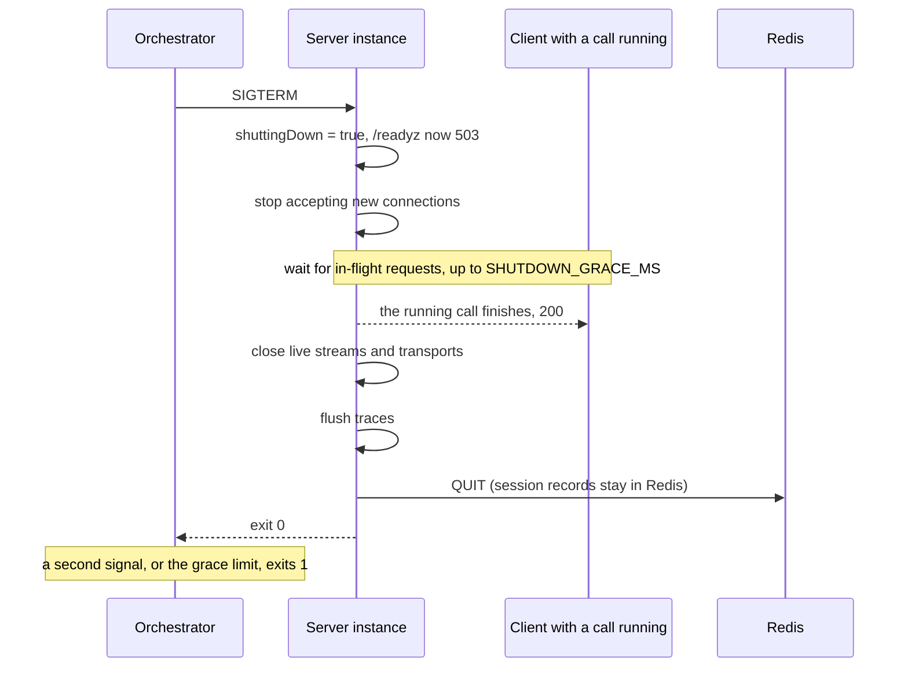

# Plan: Stage 12, observability

**Phase 2, stage 4 of 5.** Branch: `22-stage-12-observability`. Status: planned, nothing built.

## Goal

Today the server's only window is a stream of plain text lines on stderr. You cannot tell which session a line belongs to, whether an instance is ready for traffic, how many calls fail, or where the time goes in one call. Stopping it cuts every request that is running. Stage 12 makes the server something you can *watch* (structured logs, health, metrics, traces) and something you can *stop cleanly* (graceful shutdown).

## You can do this when it's done

Start the Stage 11 stack and call a tool through the proxy. Then, from the outside:

1. Find every log line of that one call with a single `grep` on its session id, even though it ran on one of two instances.
2. Ask each instance if it is ready (`/readyz`), stop Redis, and watch `/readyz` turn to `503` while `/healthz` stays `200`.
3. Read `/metrics` and see the call counted, with its duration, by tool name.
4. Open the call's trace and see one span for the HTTP request and one for the tool, joined to the caller's trace id.
5. Send `SIGTERM` while a call is running: the call finishes, the instance reports not ready, then exits `0`.

## 1. What is Stage 12?

Observability means you can answer "what is the server doing, and is it healthy?" from the outside, without attaching a debugger. There are four signals, and each answers a different question.

| Signal | Question it answers | Shape | Step |
|---|---|---|---|
| **Logs** | What happened, in order, to this session? | One JSON line per event, with fields (`session`, `req`, `trace_id`) | 12.1 |
| **Health and readiness** | Should traffic be sent here right now? | Two small HTTP endpoints | 12.2 |
| **Metrics** | How often, how fast, how many errors, over time? | Counters and histograms, scraped as text | 12.3 |
| **Traces** | Where did the time go inside one request? | A tree of timed spans with a shared trace id | 12.4 |

The fifth step is not a signal but its partner: **graceful shutdown** (12.5). When an orchestrator stops an instance it sends `SIGTERM`; a server that exits at once cuts live calls, and a server that drains finishes them first.

Key terms:

| Term | Meaning here |
|---|---|
| Structured log | A log line that is data (JSON with named fields), not a sentence you have to parse |
| Request context | The `req`, `session`, `sub` and `trace_id` of the request being handled, carried automatically to every log line it causes |
| Liveness (`/healthz`) | "The process is running and answering." Fails only if the process is stuck. No dependencies checked |
| Readiness (`/readyz`) | "This instance can do useful work now." Fails when the session store is unreachable or the instance is shutting down |
| Cardinality | How many different label values a metric has. Labels such as a session id make millions of series and break the metrics system |
| Span | One timed operation in a trace, with a name, attributes and a parent |
| Drain | Stop taking new work, finish the work in flight, then exit |

## 2. Why is it needed?

| Problem today | What happens | Stage 12 fix |
|---|---|---|
| Logs are plain sentences, none carry a session id | With two instances and many clients, you cannot follow one session. `[mcp-demo] get_weather called with …` does not say whose call it was | Every line has `session`, `req` and `instance` fields (12.1) |
| No health endpoint | An orchestrator cannot tell a stuck process from a healthy one; compose cannot wait for the servers to be ready | `/healthz` and `/readyz` (12.2) |
| Nothing counts anything | "Is it slower than yesterday?" and "how many calls fail?" cannot be answered | A `/metrics` endpoint (12.3) |
| A slow call has no breakdown | You cannot tell whether time went to the weather API, Redis or our code | Traces with a span per request and per tool (12.4) |
| `SIGTERM` exits immediately | A rolling deploy cuts every running call and every open stream | Drain, then exit (12.5) |

**Where it sits in the architecture.** Phase 2 is "make it production-ready". Stages 9 and 10 made the server safe to expose, Stage 11 made it safe to run and scale, **Stage 12 makes it possible to operate** (see it, and stop it cleanly), and Stage 13 ships it. Stage 13's Dockerfile, gateway and rollout assume the health endpoints and the clean shutdown exist.

**What it does not change.** The MCP protocol behaviour, the auth guards, the stores, and what a client sees on `/mcp`. With no new setting turned on, the server logs and behaves as it does now (see "Rollback").

## Starting point (read from the code, not run)

- **Logging.** There is no logger. `http.ts` has 13 `console.*` calls, `create-server.ts` 6 and `auth/middleware.ts` 1 (20 in all; `config.ts`, `index.ts` and the issuer CLI print their own startup messages and stay as they are). They are plain text beginning `[mcp-demo]`. The per-request line is `METHOD /path status Nms` from a Hono middleware near the top of `http.ts`. The audit log (Stage 10.4, `src/audit.ts`) is already one JSON line per tool call, and it records the tool name only, never arguments.
- **Tool lines log arguments.** `create-server.ts` logs `get_weather called with latitude=…` and `add called with a=…, b=…` on every call. That contradicts the audit rule (names only, because arguments can hold locations or paths). 12.1 deals with it (D2).
- **Health, readiness, metrics:** none. Any path other than `/mcp` and the Stage 9 metadata routes is `404`.
- **Shutdown** (`shutdown()` at the end of `http.ts`): sets a flag, stops the sweeper, calls `httpServer.close()` without waiting for it, closes every session's transport, quits Redis and calls `process.exit(0)`. There is no wait for running requests, no timeout and no second-signal handling. `serve()` from `@hono/node-server` 2.1.5 returns `Server | Http2Server | Http2SecureServer` (its `.d.mts`).
- **Things that read the log text today.** `test/helpers/http-server.ts` waits for `server running on`; `test/redis-sessions.test.ts` expects `session <id> rebuilt from the store`; `docker/kill-test.mjs` counts `server running on` and searches for `session <id> opened` and `session <id> rebuilt from the store`; the 11.4 doc greps `session $SID opened`. A logging change must not break these (D3).
- **Compose.** `docker/compose.scale.yml` has healthchecks on `redis` and `issuer` (`wget` against `/jwks.json`, which works on the Alpine image) and none on `server-a` and `server-b`.
- **SDK.** `@modelcontextprotocol/sdk` 1.32.2. A handler gets the request's `_meta` as `extra._meta` (`shared/protocol.js` sets `_meta: request.params?._meta`), and `create-server.ts` already reads `extra._meta?.progressToken`. The SDK parses `_meta` with `z.looseObject` (`types.js`), which keeps unknown keys, so a `traceparent` key should reach the handler. I have **not run** it (12.4 checks it first).

## The hard part (read this first)

Three of these steps need something to follow a request *through* code that does not know about it: the tool handler never receives the HTTP request, and the SDK calls handlers from its own promise chains.

| Need | Why it is hard |
|---|---|
| A log line inside a tool handler must carry the session id of the call | The handler gets `extra.sessionId`, but `log.info()` calls deep in other modules (store, auth, event store) do not |
| A span for a tool call must be a child of the HTTP request's span, or of the caller's trace | The two run in different layers, and MCP and HTTP trace contexts are independent (the OpenTelemetry MCP conventions say so) |
| Metrics must count tools without letting a client invent labels | A client can send any tool name; an unbounded label set is a denial of service on the metrics system |

The first two use **`AsyncLocalStorage`** (built into Node, `node:async_hooks`): the middleware stores `{ req, session, sub, trace }` for the duration of the request, and everything it awaits can read it. That is the standard answer, but whether the SDK's handler calls stay inside that context for every kind of call (POST, the long-lived GET stream, a rebuilt session) is **unverified**. 12.1 starts with a test that proves it before anything depends on it, like the 11.1 spike.

## Decisions

| # | Decision | Proposal | Status |
|---|---|---|---|
| D1 | Logger | A small `src/log.ts` of our own (levels, fields, text or JSON, request context), no new dependency. The alternative is `pino` 10.4.0 (npm). We already hand-write JSON for the audit log, and the stage is about *which fields* and *where they come from*, not about a logging library | accepted |
| D2 | Tool-argument log lines | Move them from info to `debug` (off by default). They are the only place arguments are logged, and the audit log's rule is "names only" | accepted, changes what the default log shows |
| D3 | Log text compatibility | Keep every `msg` exactly as today, including the ids inside it (`session <id> opened`), and add the fields next to it. The text format is `<today's line> key=value …`. The JSON format has `"msg":"session <id> opened"` plus `"session":"<id>"`. The redundancy is deliberate: the three readers in "Starting point" keep working unchanged | proposed |
| D4 | Format and level | `LOG_FORMAT=text\|json` (default `text`, so a laptop run looks as today) and `LOG_LEVEL=debug\|info\|warn\|error` (default `info`). Stage 13's container sets `json` | proposed |
| D5 | Request context | `AsyncLocalStorage` (built in, no package). The request log middleware opens it; session open and rebuild fill in `session`; the token check fills in `sub` | proposed, unverified (see "The hard part") |
| D6 | Where health and metrics live | A **separate admin listener** on `ADMIN_PORT`, bound to `ADMIN_HOST` (default `127.0.0.1`), off when `ADMIN_PORT` is unset. Not on the MCP port: then the Origin, auth and rate-limit guards and the proxy's `location /` never see `/metrics`, so it cannot be exposed by accident. The cost is one more port. The alternative is the MCP port with the proxy not routing them | accepted |
| D7 | Readiness checks | Not shutting down, and the session store answers (Redis `PING` within 1 s, cached 2 s; the memory store is always ok). The issuer is **not** checked: keys are cached, and an issuer outage must not take every instance out of rotation at once | proposed |
| D8 | Metrics library | `prom-client` (npm lists 15.1.3, modified 2026-08-25): a pull endpoint needs no collector. The alternative is the OpenTelemetry metrics SDK. Labels are fixed small sets only: `method`, `tool` (known names, else `other`), `status_class`, `outcome`. Never a session id or `sub` | proposed, unchecked against its docs |
| D9 | Tracing | **Manual spans** with `@opentelemetry/api` 1.10.0, `@opentelemetry/sdk-trace-node` 2.12.0 and `@opentelemetry/exporter-trace-otlp-http` 0.301.2, exported over OTLP/HTTP. No auto-instrumentation: it patches modules and our package is ESM (`"type": "module"`), where that needs extra loader setup (from memory, **unverified**). Off unless `OTEL_EXPORTER_OTLP_ENDPOINT` is set, and then the API is a no-op | proposed |
| D10 | Span names and attributes | Follow the OpenTelemetry MCP conventions: span `tools/call get_weather` (kind `SERVER`), attributes `mcp.method.name`, `gen_ai.tool.name`, `mcp.session.id`, `error.type`. The parent comes from `params._meta.traceparent` when present (SEP-414), else from the HTTP `traceparent` header. Never record `gen_ai.tool.call.arguments` or `.result` (opt-in and sensitive in the spec). These conventions are **Development** status, so names can change; we pin what we used in a comment | proposed |
| D11 | Shutdown | On `SIGTERM`/`SIGINT`: readiness goes `503`, stop accepting connections, wait for in-flight requests up to `SHUTDOWN_GRACE_MS` (default 8000, below Docker's default stop timeout of 10 s, which I have not re-checked), then close live streams and transports, flush traces, quit Redis, exit `0`. A second signal or the grace limit exits `1`. Session records stay in Redis (as in 11.2) | proposed |
| D12 | stdio and stateless modes | The logger applies to stdio too (stderr only, so the protocol channel stays clean). Health, metrics, drain and traces are for the HTTP server. Stateless mode gets all of them, minus session fields | proposed |

## Steps

**12.1 Structured logs with a session id.**
Add `src/log.ts`: levels, `LOG_FORMAT`, `LOG_LEVEL`, an `instance` field (`INSTANCE_ID` or the hostname, so logs from two instances are told apart), and a request context in `AsyncLocalStorage`. The request middleware creates `req` (a short random id) and the context; session open and rebuild set `session`; the token check sets `sub`. Replace the 20 `console.*` calls in `http.ts`, `create-server.ts` and `auth/middleware.ts` (D3 keeps the text). Move the argument-logging lines to `debug` (D2). Leave the audit log's shape alone (its tests stay), but let it carry `req` and `trace_id` when they exist. Start with the context test from "The hard part".
*Files:* `src/log.ts` (new), `src/http.ts`, `src/create-server.ts`, `src/auth/middleware.ts`, `src/config.ts`, `packages/server/.env.example`, `test/log.test.ts` (new).
*Done when:* in JSON mode a tool's log line has the right `session` and `req` (proven for a POST call, a rebuilt session and a `GET` stream); in text mode every existing line still starts with today's text and the 3 readers in "Starting point" pass unchanged; a token never appears in any line; the argument lines are gone at `info` and back at `debug`.

**12.2 Health and readiness.**
Add `src/admin.ts`: a second `serve()` on `ADMIN_PORT`/`ADMIN_HOST` (D6) with `GET /healthz` (always `200` while the process answers) and `GET /readyz` (D7; `503` with a JSON reason otherwise). A `shuttingDown` flag from `http.ts` feeds readiness (12.5 uses it). Add a `healthcheck` to `server-a` and `server-b` in the compose file (`wget` against `/readyz`, as the issuer already does) and make the proxy wait for them.
*Files:* `src/admin.ts` (new), `src/http.ts`, `src/config.ts`, `docker/compose.scale.yml`, `test/admin.test.ts` (new), `.env.example`.
*Done when:* with `SESSION_STORE=redis` and Redis stopped, `/readyz` is `503` and `/healthz` is `200`, and after Redis is back `/readyz` is `200` again; `/healthz` on the MCP port is `404`; with `ADMIN_PORT` unset nothing listens; compose waits for both servers to be healthy.

**12.3 Metrics.**
Add `src/metrics.ts` with a `prom-client` registry (D8) and `GET /metrics` on the admin listener. Instruments: requests by `method` and `status_class` with a duration histogram; tool calls by `tool` and `outcome`; sessions active (gauge, from `sessions.size`); session rebuilds; store unavailable errors; `429` rate-limited; `401` and `403` auth refusals; stored and replayed stream events. Plus the library's default process metrics (memory, CPU, event-loop lag). Hook points: the request middleware, the audit wrapper (it already sees every tool call), and the places that already log "rebuilt" and "unavailable".
*Files:* `src/metrics.ts` (new), `src/http.ts`, `src/audit.ts`, `src/admin.ts`, `package.json` (`prom-client`), `test/metrics.test.ts` (new).
*Done when:* after a known mix of calls `/metrics` shows matching counts; 50 calls with 50 different made-up tool names add one series (`other`), not 50; no label holds a session id or `sub`; `/metrics` is not reachable on the MCP port.

**12.4 OpenTelemetry traces.**
Add `src/tracing.ts`: start the SDK when `OTEL_EXPORTER_OTLP_ENDPOINT` is set (validated in `config.ts`), otherwise leave the no-op API. A middleware span per HTTP request (parent from the `traceparent` header), and a span per `tools/call` made where the audit wrapper already wraps the handler (D10; parent from `params._meta.traceparent` when present). Put `trace_id` and `span_id` on every log line inside a span. First, a check that a custom `_meta` key (`traceparent`) reaches `extra._meta`; the schema should keep it (see "Starting point"), but it has not been run.
*Files:* `src/tracing.ts` (new), `src/http.ts`, `src/audit.ts`, `src/log.ts`, `src/config.ts`, `package.json` (3 packages), `test/tracing.test.ts` (new, with the SDK's in-memory exporter), a trace backend for the compose stack (to choose in this step).
*Done when:* a `tools/call` makes a `SERVER` span named `tools/call <tool>` with the D10 attributes; a `traceparent` in `_meta` becomes its parent; the log line for the call has the same `trace_id`; no argument or result is in any attribute; with the endpoint unset, no SDK is created.

**12.5 Graceful shutdown.**
Rewrite `shutdown()` (D11): count in-flight requests in the middleware; on the signal set `shuttingDown`, stop accepting, wait for the count to reach zero or `SHUTDOWN_GRACE_MS`, then close streams and transports, flush the tracer, quit Redis and exit. A second signal exits `1`. Keep the records in Redis. `serve()` returns a union that includes HTTP/2 types, so the connection-closing methods need a type narrow; their behaviour is **unverified** until this step.
*Files:* `src/http.ts`, `src/tracing.ts`, `src/admin.ts`, `src/config.ts`, `test/shutdown.test.ts` (new), `.env.example`. A running call to drain needs a controllable slow tool or delay; whether to add a test-only hook is open.
*Done when:* `SIGTERM` during a running call lets it return `200`, then the process exits `0` inside the grace; `/readyz` is `503` as soon as the signal arrives; a held-open stream is closed at the grace limit; a second signal exits `1`; the 11.4 kill test (which uses `docker compose stop`) still passes.

Then the branch doc (ending with **Try it end to end** and a **Test it yourself** subsection under every step, per `constitution/planning.md`), a **New packages** table (`prom-client` and the OpenTelemetry packages), the README row and the roadmap page.

## 3. How do we implement it?

### Architecture, today and after



The admin port is a second listener inside the same process. It reads the same state (shutting down, store reachable, metrics registry) but never shares the guards or the proxy route of `/mcp`.

### What one request does after Stage 12



Each box that logs reads the request context, so none of them is passed a session id by hand.

### A log line, today and after

Today:

```
[mcp-demo] session 3f1c9a opened (1 active)
```

After, with `LOG_FORMAT=json`:

```json
{"time":"2026-11-22T09:14:02.118Z","level":"info","instance":"server-a","req":"r7k2","session":"3f1c9a","sub":"alice","msg":"session 3f1c9a opened (1 active)"}
```

After, with `LOG_FORMAT=text` (the default): the same text as today followed by `req=r7k2 session=3f1c9a instance=server-a`. Following one session across two instances becomes `docker compose logs server-a server-b | grep 3f1c9a`.

### Health and readiness



Why two endpoints: if liveness checked Redis, a Redis outage would make the orchestrator *restart* every healthy server, which does not help and makes it worse. Liveness answers "restart me?", readiness answers "send me traffic?".

### Shutdown, step by step



With the Stage 11 proxy, a stopped instance is skipped after its first failed connection (passive health only; open-source nginx has no active health checks), so `/readyz` helps compose and an orchestrator, not the proxy itself.

### Components and files

| Component | New or changed | Job |
|---|---|---|
| `src/log.ts` | new in 12.1 | Levels, text and JSON output, request context in `AsyncLocalStorage` |
| `src/admin.ts` | new in 12.2 | Second listener: `/healthz`, `/readyz`, `/metrics` |
| `src/metrics.ts` | new in 12.3 | `prom-client` registry and the instruments |
| `src/tracing.ts` | new in 12.4 | Start the SDK when configured, helpers to start spans and read `traceparent` |
| `src/http.ts` | all steps | Request context, in-flight count, hooks for metrics and spans, the new `shutdown()` |
| `src/audit.ts` | 12.1, 12.3, 12.4 | Already wraps every `tools/call`: carries `req` and `trace_id`, records the metric and the tool span |
| `src/config.ts` | all steps | `LOG_FORMAT`, `LOG_LEVEL`, `INSTANCE_ID`, `ADMIN_PORT`, `ADMIN_HOST`, `OTEL_EXPORTER_OTLP_ENDPOINT`, `SHUTDOWN_GRACE_MS`, validated at startup like the rest |
| `docker/compose.scale.yml` | 12.2, 12.4 | Server healthchecks, a trace backend |

### Dependencies

| Dependency | Needed for | Status |
|---|---|---|
| `AsyncLocalStorage` (`node:async_hooks`) | request context (D5) | built into Node, no package; behaviour with the SDK not verified |
| `prom-client` | metrics (D8) | npm shows 15.1.3 (engines `^16 \|\| ^18 \|\| >=20`); not installed, not tried |
| `@opentelemetry/api` | spans (D9) | npm shows 1.10.0; not installed |
| `@opentelemetry/sdk-trace-node` | span processing (D9) | npm shows 2.12.0 (a 2.x version); not installed |
| `@opentelemetry/exporter-trace-otlp-http` | sending spans (D9) | npm shows 0.301.2 (a 0.x version) and `engines.node` `>=22.15.0`; not installed |
| A trace backend for compose | seeing traces (12.4) | not chosen. A collector with a console exporter or a Jaeger image would do; image names and ports are not verified |
| Node version | the exporter's `engines` | CI pins 24.22.2 and the default here is 22.23.4, both above 22.15.0. The repo sets no `engines` field |

Versions above came from `npm view` and the OpenTelemetry MCP semantic-conventions page on 2026-11-22. Nothing is installed or run yet. Each package is explained in the branch doc's **New packages** table in the step that adds it.

## 4. How do we integrate it without breaking what exists?

| Existing piece | Effect of Stage 12 | How it stays safe |
|---|---|---|
| Log text readers (`http-server.ts` helper, `redis-sessions.test.ts`, `kill-test.mjs`, 11.4 doc greps) | `msg` text is unchanged (D3) | Their tests run unchanged in 12.1; a break means the step is not done |
| Audit log (10.4) | Same shape; may gain `req` and `trace_id` | `audit.test.ts` keeps passing; new fields are optional |
| Auth, scopes, Origin, size and rate guards (9, 10) | Unchanged; each refusal is counted and logged | The admin listener is a separate app, so it never passes through them and they never see it |
| Session store and rebuild (11) | `/readyz` pings the store; rebuilds and store errors are counted | No change to what is stored or replayed |
| Event store (11.3) | Stored and replayed counts become metrics | The `log` callback that already exists for `EVENT_STORE_DEBUG` stays |
| `shutdown()` (today: fast exit) | Becomes a drain with a limit | The kill test and the "SIGTERM keeps records" behaviour are re-run; a stuck stream cannot block forever because of the grace limit |
| Compose stack (11.4) | Servers get healthchecks; a trace backend is added | The kill test does not depend on either |
| Stateless mode and stdio | Logger only for stdio; stateless gets the rest (D12) | Their tests are unchanged |

**Order of work keeps the server shippable at every step.** 12.1 changes no output at the default settings except the moved argument lines (D2). 12.2 and 12.3 add a listener that is off unless `ADMIN_PORT` is set. 12.4 is off unless the OTLP endpoint is set. 12.5 is the only step that changes default runtime behaviour (how `SIGTERM` ends), and it is bounded by the grace limit.

**Rollback.** Leave `LOG_FORMAT`, `ADMIN_PORT` and `OTEL_EXPORTER_OTLP_ENDPOINT` unset and the server logs and serves as in Stage 11. Set `SHUTDOWN_GRACE_MS=0` to get the old fast exit back.

### Testing strategy

| Level | What | How |
|---|---|---|
| Spike | Request context survives the SDK for POST, a rebuilt session and the `GET` stream | A throwaway test first (12.1), result written in this plan |
| Unit | Log levels, both formats, field order, context lookups; the readiness decision table; metric label bounds | Plain Vitest tests, no server |
| Integration | Real compiled server: a tool call's log line has the right `session` and `req`; `/readyz` follows Redis; `/metrics` counts match | The existing `http-server.ts` helper, Redis tests only when `REDIS_URL` is set |
| Compatibility | The log text readers still pass | The existing tests, unchanged, are the check |
| Security | No token, `sub` secret, argument or result in a log line, metric label or span; `/metrics` unreachable on the MCP port; `ADMIN_HOST` defaults to loopback | Search captured output for a known token and known arguments |
| Tracing | Span name, kind, attributes, parent from `_meta` and from the HTTP header | The SDK's in-memory exporter |
| Shutdown | Drain finishes a running call, held stream closed at the limit, second signal exits `1`, exit codes | Spawn the server, send signals |
| Mutation | Remove the context, the label allow-list, the readiness store check, the in-flight wait | The matching test must fail, then restore |
| Compose | Healthchecks gate the proxy; the kill test still passes; one trace seen end to end | By hand with Docker, as in 11.4 |

CI runs `pnpm test` as before; Docker steps stay by hand (no Docker in CI today).

### Practical example, from clean start

1. `docker compose -f docker/compose.scale.yml up -d --wait` starts the stack; the servers are now waited for by their healthchecks.
2. Open a session and call a tool through `localhost:4790`, as in the 11.4 steps.
3. `docker compose -f docker/compose.scale.yml logs server-a server-b | grep <session id>` shows every line of that session, from whichever instance, each with `session`, `req` and `instance`.
4. Read `/metrics` on an instance's admin port from inside its container; the call is counted under its tool name.
5. Stop Redis: `/readyz` becomes `503`, `/healthz` stays `200`. Start it: `/readyz` is `200` again.
6. Start a slow call, then `docker compose stop server-a`: the call finishes, the log shows the drain, the container exits `0`.

This is the shape of the Stage 12 end-to-end steps. Nothing here has been run yet.

## Behaviour table (the proof)

| Situation | Answer |
|---|---|
| A tool call, `LOG_FORMAT=json` | Every line it causes has the same `req` and the call's `session` |
| Two instances, grep one session id | Lines from whichever instance served it, each with its `instance` |
| Default settings, laptop run | Lines look as today, plus a short `key=value` tail; no listener but `/mcp` |
| `GET /healthz` with the store down | `200` (the process is fine; restarting it would not help) |
| `GET /readyz` with the store down, or while shutting down | `503` with a reason |
| `GET /readyz` on the MCP port | `404` |
| A client sends 50 different made-up tool names | Metrics get one extra series, `other` |
| A `tools/call` with `traceparent` in `_meta` | Its span has that trace id; the log line has the same `trace_id` |
| `OTEL_EXPORTER_OTLP_ENDPOINT` unset | No SDK is created; spans are no-ops |
| `SIGTERM` while a call is running | The call returns `200`, then the process exits `0` within the grace |
| `SIGTERM` while a stream is held open | The stream is closed at the grace limit, then exit |
| A second signal during the drain | Exit `1` immediately |
| `LOG_LEVEL=warn` | `info` lines and `debug` lines are not printed |

## Risks

- **Context may be lost inside the SDK.** If its handler calls run outside the request's `AsyncLocalStorage` context for some call types, lines would have no `session`. That is why 12.1 starts with a test, and the fallback is to pass `extra.sessionId` explicitly in the handlers (the audit wrapper already does).
- **Log text is an interface.** Three readers and the docs match exact lines. D3 protects them; any step that edits a message must update its readers in the same commit.
- **Cardinality.** One label built from client input (a tool name, a session id, a `sub`) can create unbounded series. D8's allow-list and the test with 50 made-up names are the guard.
- **`/metrics` leaks information** (names, counts, process details). D6 keeps it off the MCP port and on loopback by default; exposing it is a deliberate act in Stage 13.
- **Readiness can flap or hammer Redis.** Hence the 1 s timeout and 2 s cache (D7).
- **The OpenTelemetry MCP conventions are in Development status.** Attribute and metric names may change; the plan pins what it used.
- **The exporter packages are 0.x** (`0.301.2`), so their API can change between minor versions. Pin exact versions when installing.
- **ESM and auto-instrumentation.** Avoided on purpose (D9), but it means no automatic spans for outgoing `fetch` calls to the weather API or Redis commands. They would need manual spans, which is optional work.
- **`serve()` returns a union type.** The connection-closing calls need narrowing, and HTTP/2 servers lack some of them; verify in 12.5.
- **Drain versus the proxy.** Open-source nginx cannot read `/readyz`, so a draining instance is only skipped after it refuses a connection. Clients with a call mid-flight on the dying instance still lose it if the grace runs out. Resumable streams (11.3) only replay what was stored.
- **Per-instance everything.** Logs, metrics and rate limits are per instance (as D5 of Stage 11 says for limits). Totals need a scraper that sums instances; we do not run one.
- **Tool argument logs.** Moving them to `debug` (D2) changes what a default run prints; some will miss them.
- **Not run yet:** nothing in this plan has been tried, including `AsyncLocalStorage` with the SDK, `prom-client`, the OpenTelemetry packages, and the shutdown calls. Treat library details as unverified until each step.

## Out of scope

Collecting and storing logs (Loki, ELK), dashboards and alert rules, running a Prometheus or Grafana server, the OpenTelemetry metrics and logs signals, auto-instrumentation, sampling policy beyond the SDK default, spans for Redis and the weather API (possible later), Redis's own metrics, and everything in Stage 13 (Dockerfile, TLS, the gateway, the deploy pipeline).
